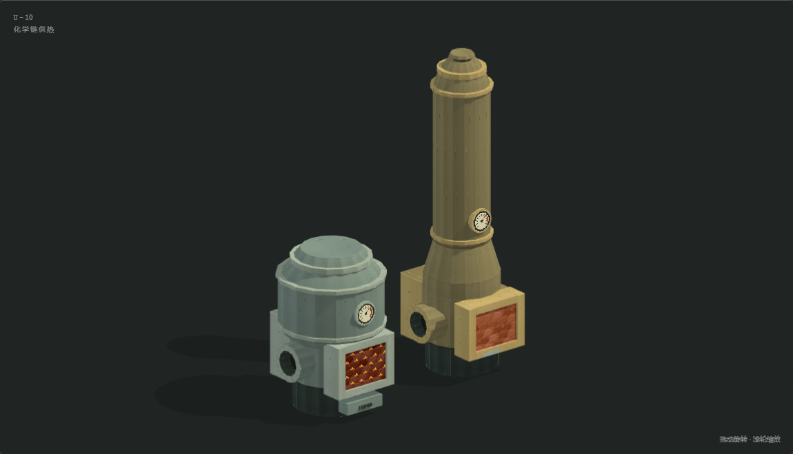
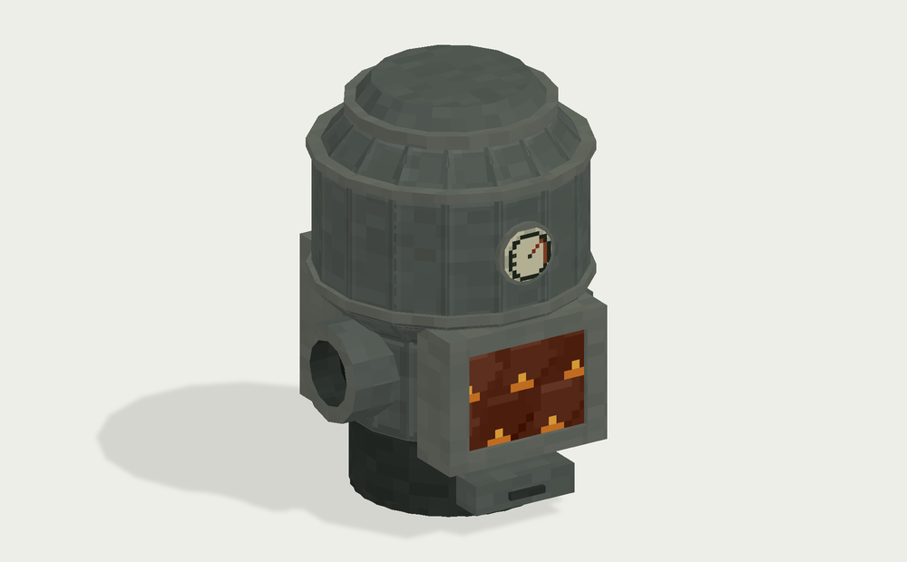
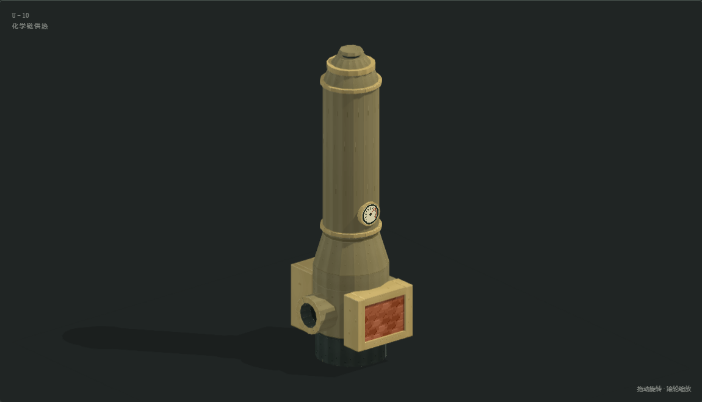

# 化学链燃料床与再生床

参考 HBM 的厚板圆筒和像素材质制作，保持简洁外观。两台均保留 **1×1 格占地**，燃料床为 **1.5 格高的矮宽鼓泡床**，再生床为 **3 格高的细长快速床／提升管**；没有基座、支脚、护栏或复杂外露管路。

逻辑仍各占底部一个方块，上部只是外观。所有功能口的中心对齐底部逻辑方块面；机器、接口路由和游戏渲染尚未接入。

| 模型 | 可视包络（宽 × 高 × 深） | 主筒直径 | 三角面 | 部件 |
| --- | --- | --- | --- | --- |
| 燃料床 | 1 × 1.5 × 1 | 0.96 格 | 1,680 | 18 |
| 再生床 | 1 × 3 × 1 | 下床 0.70 格，提升管 0.52 格 | 1,976 | 18 |

[同尺度旋转对照](comparison.html)（本地生成）将两台放在同一场景，使用同一方块单位；[格线对照](comparison_grid.png) 显示高度差。预览中模型并列摆放，不表示两机之间有固定连接。



## 燃料床



- [完整 OBJ](fuel_reactor/fuel_reactor.obj)、[剖视 OBJ](fuel_reactor/fuel_reactor_cutaway.obj)。
- [MTL](fuel_reactor/fuel_reactor.mtl)、[512×256 像素图集](fuel_reactor/fuel_reactor_atlas.png)、[部件与坐标清单](fuel_reactor/model.json)。
- [离线交互预览](fuel_reactor/preview.html)（本地生成，不入库）。
- [剖视](fuel_reactor/preview_cutaway.png)、[正面](fuel_reactor/preview_front.png)、[背面](fuel_reactor/preview_back.png)、[右侧](fuel_reactor/preview_side.png)、[俯视](fuel_reactor/preview_top.png)。

正面投料与点火共用一个口，焦炭、木炭及赤铁矿粉从同处加入；下部保留灰门。宽筒内有布风板、较密的床料及低位流化颗粒。右侧为排出 CO₂ 和水的小圆管，底面预留固体输出。

## 再生床



- [完整 OBJ](air_reactor/air_reactor.obj)、[剖视 OBJ](air_reactor/air_reactor_cutaway.obj)。
- [MTL](air_reactor/air_reactor.mtl)、[512×256 像素图集](air_reactor/air_reactor_atlas.png)、[部件与坐标清单](air_reactor/model.json)。
- [离线交互预览](air_reactor/preview.html)（本地生成，不入库）。
- [剖视](air_reactor/preview_cutaway.png)、[正面](air_reactor/preview_front.png)、[背面](air_reactor/preview_back.png)、[右侧](air_reactor/preview_side.png)、[俯视](air_reactor/preview_top.png)。

下部床筒向上收细为提升管，内部颗粒沿细管高度分布，顶端保留短排气帽。正面是载体投料口。右侧空气入口为无图案的小圆管：外径 0.36 格、净口直径 0.24 格，管口对齐右侧方块面中心；没有整块入口面板、流体标识、风机、叶轮或自制通风覆盖板。

## 坐标、材质与接入边界

1 OBJ 单位 = 1 方块，`+Y` 向上，`-Z` 为正面；原点是逻辑方块最小角。燃料床网格位于 `(0,0,0)` 至 `(1,1.5,1)`，再生床位于 `(0,0,0)` 至 `(1,3,1)`。筒体高宽比、接口尺寸与坐标写在各自 `model.json` 中。

| 面 | 中心 `(X,Y,Z)` | 造型与用途 |
| --- | --- | --- |
| 左 `-X` | `(0,0.5,0.5)` | 0.25×0.25 格的凸出 KU 接口，沿用用户提供的 GT6 方形图案，按灰绿钢与暗青铜机壳分别配色 |
| 后 `+Z` | `(0.5,0.5,1)` | HU 方形烟道口，外框 0.6×0.6 格、净口 0.5×0.5 格，内壁有深度，没有 HU 字母 |
| 前 `-Z` | `(0.5,0.5,0)` | 燃料床为共用投料／点火口，再生床为载体投料口 |
| 右 `+X` | `(1,0.5,0.5)` | 圆管开口，燃料床排出 CO₂ 和水，再生床进气 |
| 下 `-Y` | `(0.5,0,0.5)` | 固体输出预留 |

HU 口按现有热网烟道的 0.5 格管身与 0.6 格法兰尺寸制作，开口处没有实心盖板，深处为暗色内壁。两台正面圆形表盘直径均为 0.20 格。上述尺寸与坐标为美术接口约定。

OBJ、MTL 和对应 PNG 保持在同一目录；使用不透明图集、平面法线、最近邻过滤和背面剔除。床料图案为静态像素纹理，不含运行状态或自发光行为。

离线预览支持拖动旋转、缩放、五个视角、剖视、方块边界和部件高亮；方向键旋转、`+` / `-` 缩放、`Home` 复位。各自格线图：[燃料床](fuel_reactor/preview_grid.png)、[再生床](air_reactor/preview_grid.png)。预览内嵌网格和贴图，不访问 CDN。

游戏接入仍需配置对应高度的渲染包围盒、遮挡剔除、碰撞和选中形状。两台之间的载体运输由玩家物流完成。

## 参考、生成与检查

本机 HBM 参考来自 `Hbm-s-Nuclear-Tech-GIT/src/main/resources/assets/hbm/models/machines/` 中的 `boiler.obj`、`industrial_boiler.obj`、`chemical_plant.obj`、`catalytic_cracker.obj` 及对应贴图。参考其工业造型和像素处理方式；生成器不读取或复制 HBM 网格、UV 或贴图。

KU 接口采用与用户附件一致的 `machines/generators/motor_liquid/overlay/sides.png`，裁取中央 `(4,4)-(12,12)` 的 8×8 方形。生成器保留原图明暗并按各自机壳上色，再以最近邻贴到小接口上。原图用于 GT6 液体马达侧壳。

这些原图来自本机 GT6CE 的 `core/src/main/resources/assets/gt6ce/textures/block/`；CC0-1.0 依据见该项目 `META-INF/licenses/original-gt6/LICENSE.assets` 与 `COPYING.assets`。实际使用的来源、许可、SHA-256 和裁剪范围均记录在 `model.json` 的 `texture_references`；其余网格和像素绘制由本模型输入生成。

在仓库根目录执行，需要 Python 3 和 Pillow；完整检查还需要 Playwright 及 Chromium：

```powershell
python scripts/models/build_chemical_looping_beds.py
python scripts/models/inspect_chemical_looping_beds.py
# 仅检查导出的文件：
python scripts/models/inspect_chemical_looping_beds.py --geometry-only
```

输入是 `scripts/models/build_chemical_looping_beds.py`、`chemical_looping_materials.py`、`chemical_looping_viewer.html` 以及 `scripts/models/references/` 的 GT6 原始叠层副本，复用 `build_fluidized_bed.py` 的几何原语、`lithography_machine_materials.py` 的像素字形及 `viewer_shell.css`；独立检查复用 `inspect_lithography_machine.py` 的 OBJ 解析器。修改输入再生成，不手改 OBJ、MTL、图集或预览。`scripts/models/` 和交互 HTML 已按仓库规则忽略，只存在于当前工作副本；仅克隆已提交资产不能重建。

检查解析实际 OBJ/MTL，核对坐标、索引、法线、UV、面序、退化面、材质引用、剖视一致性、接口面中心、KU 小接口、HU 开孔、再生床圆管和两机筒体比例。浏览器检查交互、格线、窄屏和错误，并生成截图；报告位于 `build/chemical-looping-beds-qa/report.json`。

2026-11-04 完整检查通过 85 项，刷新 16 张 WebGL 截图。独立检查确认两台圆管口、0.20 格表盘直径、KU 贴图与机壳配色，以及 1.5 格与 3 格的可视高度。

本次不涉及 Java 实现；Forge / NeoForge 游戏内光照、渲染、碰撞、点火、通风板安装和机器行为尚未验证。

2026-11-04 后续把两套 OBJ 与图集接入 `common/src/main/resources/assets/ssite/`，并实现 `ssite:fuel_reactor`/`ssite:air_reactor` 的批次行为、HU 口与不打开 GUI 的交互；实机与客户端验收仍待统一批次执行。`model.json` 里的 `integrated_in_game` 仍是生成时的美术状态，未手改生成产物。
