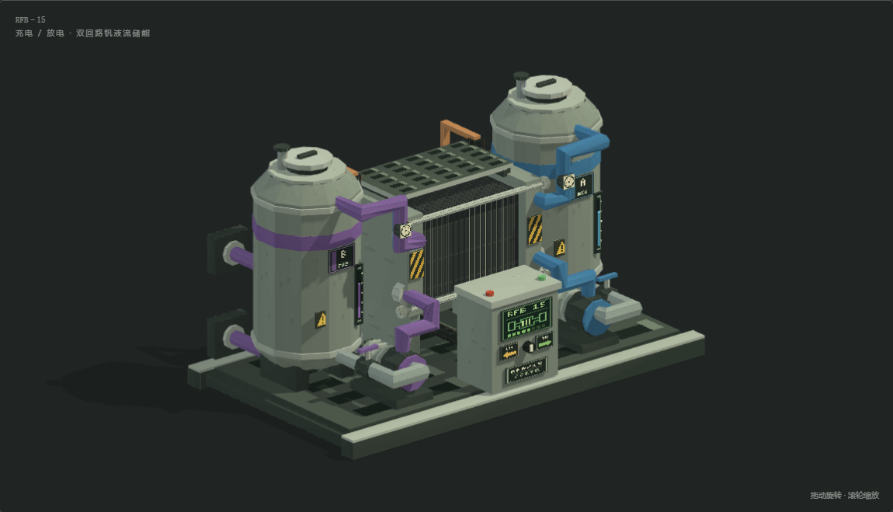
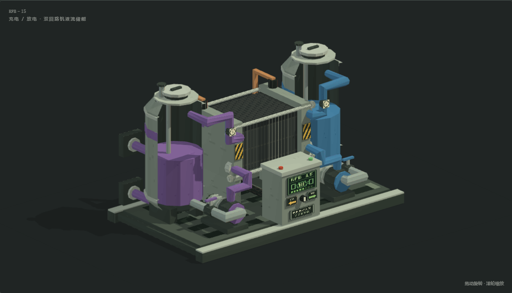

# 液流堆 RFB–15（充 / 放电整机）

参考 HBM 的低饱和灰绿机壳、厚端板、重复叠片与像素仪表制作的原创 OBJ。中央是可见的石墨双极板 / 隔膜电堆，两侧是蓝、紫标识的独立循环缓冲筒；前置双循环泵和充放电控制柜，后置双向变流柜、铜母排与外接储罐接口。

**宽 5 × 深 3 × 高 3 方块，5,132 个三角面、40 个具名部件，单张 512×256 像素图集。** 同一台设备用于充电与放电。当前是美术资产，尚未接入 U-15 的机器行为、库存、碰撞或游戏渲染。



## 文件与导入

| 文件 | 内容 |
| --- | --- |
| [flow_battery.obj](flow_battery.obj) | 完整整机，三角面、平面法线、具名 `o` / `g` 部件 |
| [flow_battery_cutaway.obj](flow_battery_cutaway.obj) | 移除前筒壳、前箍、罐侧仪表和上部保护罩的剖视版本 |
| [flow_battery.mtl](flow_battery.mtl) | 两个 OBJ 共用的单材质定义 |
| [flow_battery_atlas.png](flow_battery_atlas.png) | RGB 像素图集 |
| [model.json](model.json) | 尺寸、部件、候选接口位置与剖视隐藏列表 |
| [preview.html](preview.html) | 内嵌全部网格、图集和渲染代码的离线交互预览；仅在本地生成、不入库 |
| [剖视](preview_cutaway.png) | 筒内工作液、回流管与叠片电堆 |
| [正面](preview_front.png)、[背面](preview_back.png)、[右侧](preview_side.png)、[俯视](preview_top.png) | 实际 WebGL 渲染截图 |

导入时保持 OBJ、MTL、PNG 同目录和文件名不变。1 OBJ 单位 = 1 方块，`+Y` 向上、`-Z` 为正面；原点位于整体包络最小角，所有几何位于 `(0,0,0)` 至 `(5,3,3)`。使用最近邻贴图过滤、平面着色、背面剔除；材质不透明，不需要透明排序或法线贴图。

交互预览支持拖动旋转、滚轮缩放、五个视角、剖视、方块网格、分组高亮、接口编号与充放电连接示意。方向键旋转，`+` / `-` 缩放，`Home` 复位。工况选项只改变连接说明，OBJ 不存储动画或能量机制。

## 结构与接入边界



电堆采用 18 组可辨认的叠片、浅色隔膜边缘、厚压紧端板和四根贯穿拉杆。两条液路分别从缓冲筒连接循环泵、下部电堆歧管和上部回液管；蓝紫色只用于区分回路，不表示真实钒价态或初始荷电状态。控制柜上的 CHG / DIS 标识表示同机切换工况。

缓冲筒用于完整设备的外观表达，外部储罐仍可扩容。两只可见筒体不等于冻结了运行时罐数；充电态 / 放电态液体、库存与管网路由需按 U-15 的实际方案实现。当前不改变流体 ID、配方或能源账。

背面候选接口均朝 `+Z`，中心对齐方块外表面：

| 接口 | 方块格 `(X,Y,Z)` | 外表面中心 | OBJ 分组 |
| --- | --- | --- | --- |
| A 侧进液 | `(0,0,2)` | `(0.5,0.5,3)` | `port_a_in` |
| A 侧回液 | `(0,1,2)` | `(0.5,1.5,3)` | `port_a_out` |
| B 侧进液 | `(4,0,2)` | `(4.5,0.5,3)` | `port_b_in` |
| B 侧回液 | `(4,1,2)` | `(4.5,1.5,3)` | `port_b_out` |
| EU 双向电口 | `(2,0,2)` | `(2.5,0.5,3)` | `power_port` |

这是美术候选布局，尚未绑定多方块结构和可交互面。接入时仍需冻结控制器位置、旋转变换、渲染包围盒、碰撞和真实接口路由。

## 参考、生成与检查

参考本机 `Hbm-s-Nuclear-Tech-GIT/src/main/resources/assets/hbm/models/machines/` 的 `electrolyser.obj`、`chemical_plant.obj`、`battery.obj`、`fensu.obj` 及对应贴图。参考其轮廓、叠片、面板和像素处理方式；生成过程不读取或复制 HBM 的网格、UV、贴图。

在仓库根目录执行，需要 Python 3、Pillow；完整检查另需 Playwright 与 Chromium：

```powershell
python scripts/models/build_flow_battery.py
python scripts/models/inspect_flow_battery.py
# 只校验导出的几何与资源：
python scripts/models/inspect_flow_battery.py --geometry-only
```

生成输入是 `scripts/models/build_flow_battery.py`、`flow_battery_materials.py`、`flow_battery_viewer.html`；复用 `build_fluidized_bed.py` 的基础几何、`lithography_machine_materials.py` 的像素字形和 `viewer_shell.css`。独立检查复用 `inspect_lithography_machine.py` 的 OBJ 解析器。修改生成器再重新导出，不手改产物。`scripts/models/` 与交互 HTML 按仓库规则忽略，仅存在于本地工作副本；仅克隆已提交美术产物不能重建。

检查直接解析 OBJ / MTL，验证索引、有限坐标、法线、UV、面序、非退化三角形、相对资源路径、包络、部件、剖视一致性和接口中心；完整检查还覆盖实际 WebGL 渲染、视角、剖视、鼠标键盘、工况说明、接口选择与 360px 布局。报告输出到 `build/flow-battery-qa/report.json`。

2026-11-04：生成与完整检查命令通过，共 15 组检查，已生成六张实际 WebGL 截图。无页面、控制台或 WebGL 错误，无外部网络请求；360px 预览无横向溢出。已查看整机、剖视与背面，核对电堆、独立液路和接口。

本次不涉及 Java 实现，不需要编译模组。Forge / NeoForge 游戏内加载、光照、碰撞、交互和充放电行为尚未验证。
