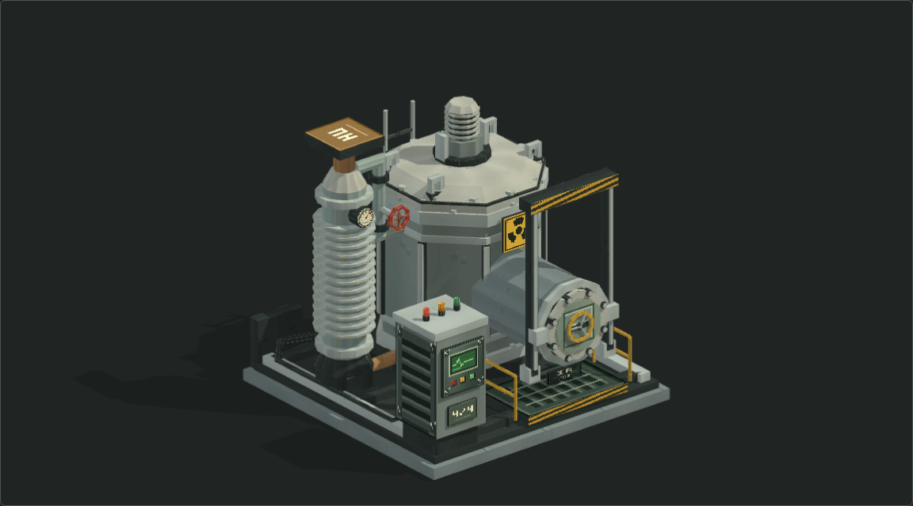

# 批次照射反应堆 IR–03

参考 HBM 核工业设备的造型语言制作的原创低多边形模型。厚重的八角屏蔽舱、前部滑升装料门、侧置换热柱和独立仪表柜共同组成完整设备，顶部带索引驱动、螺栓顶盖与吊耳。灰绿机壳、暖灰屏蔽层、炭黑接缝配少量黄黑警示纹；仪表、铭牌和局部磨损使用像素贴图。

**占地严格为 4×4 方块，高度 4 格。** 底座、静态模型和开门、旋转全过程都限制在 `(0,0,0)` 至 `(4,4,4)` 的包络内。接口中心位于整数方块格的外表面中心。它是美术资产及离线动画，尚未接入游戏；游戏中的结构判定、碰撞、接口位置和机器行为仍以现有 Java 实现为准。后续接入时需将这里的结构坐标映射到新的多方块判定。



## 文件

| 文件 | 内容 |
| --- | --- |
| [preview.html](preview.html) | 内嵌网格、贴图和动画的离线 WebGL 2 预览，无 CDN 或网络依赖 |
| [irradiation_reactor.obj](irradiation_reactor.obj) | 完整模型，41 个具名部件、9,144 个三角面，平面法线；停机、门关闭的初始姿态 |
| [irradiation_reactor_cutaway.obj](irradiation_reactor_cutaway.obj) | 隐去前半屏蔽壳与顶盖的剖视版本 |
| [irradiation_reactor.mtl](irradiation_reactor.mtl) | 两份 OBJ 共用的材质定义 |
| [irradiation_reactor_atlas.png](irradiation_reactor_atlas.png) | 512×256 RGB 像素图集，使用最近邻过滤 |
| [model.json](model.json) | 方块包围盒、接口格与朝向、部件中英文对照、剖视隐藏列表、动画参数和网格检查结果 |
| [irradiation_reactor_animation.js](irradiation_reactor_animation.js) | 可复用的启停、门锁、滑升门、转速和照明状态机；由生成器导出 |
| [preview_cutaway.png](preview_cutaway.png) | 剖视截图 |
| [preview_front.png](preview_front.png)、[preview_back.png](preview_back.png)、[preview_side.png](preview_side.png)、[preview_top.png](preview_top.png) | 正面、背面、右侧与俯视截图 |
| [preview_running.png](preview_running.png)、[preview_running_cutaway.png](preview_running_cutaway.png) | 运行外观与内部照明 |
| [preview_door_open.png](preview_door_open.png)、[preview_door_open_front.png](preview_door_open_front.png)、[preview_ports.png](preview_ports.png) | 开门姿态、正面通道与接口方块格 |
| [preview_animation.gif](preview_animation.gif) | 从真实预览帧录制的开门、启停与剖视动画，压缩时间的过程演示；实际时序以交互预览为准 |

预览支持拖动旋转、滚轮缩放、五个预设视角、方块网格、接口格、部件高亮与剖视，以及启动/停机、装料门开关、暂停/继续和动画复位。键盘方向键旋转，`+` / `-` 缩放，`Home` 回到全貌。

## 坐标与部件

1 OBJ 单位 = 1 方块，`+Y` 向上、`-Z` 为正面，原点是 4×4×4 结构包络的最小角。反应舱轴心位于 `X=1.5, Z=2.5`。方块坐标按零起始的 `(X,Y,Z)` 记录：

| 接口 | 所在方块格 | 外表面中心 | 朝向 |
| --- | --- | --- | --- |
| 装料 / 取料 | `(1,1,0)` | `(1.5,1.5,0)` | 前方 `-Z` |
| 控制面板 | `(3,1,0)` | `(3.5,1.5,0)` | 前方 `-Z` |
| KU 输入 | `(3,0,3)` | `(3.5,0.5,4)` | 后方 `+Z` |
| HU 输出 | `(3,3,2)` | `(3.5,4,2.5)` | 顶部 `+Y` |

装料口由屏蔽门、手轮与通道共同组成；手轮最前端落在 `Z=0`，门板本身稍向内退。朝北放置时，若以控制器方块最小角为渲染原点，模型坐标平移 `(-3,-1,0)`；其余水平朝向绕控制器中心旋转。坐标与分组已记录在 `model.json`，不代表游戏已采用此接口布局。

主体前后壁、带箍和加强筋分别分组；装料通道贯穿前壁和内衬，门板、手轮、压爪、导轨、顶盖、螺栓、传动轴均可独立选择。内构分为 `source_capsule`、`sample_carousel`、`target_capsules`、`interior_liner` 和 `chamber_lights`。完整列表见 `model.json`。

## 动画与照明

- 开门：停转且运行灯熄灭后，手轮先解锁半圈，再将屏蔽门沿导轨升高 1.24 格。门板与压爪同步移动，通道和导轨固定。
- 启动：若门已开，先落门、锁紧手轮；随后转台、四支靶匣和顶部传动轴在 2.2 秒内加速到 5 rpm。灯光渐亮，运行指示灯点亮。
- 停机：转动部件在 3 秒内减速，舱内灯光渐灭，完全停止后才能再次开门。静止的机壳、源柱、管路和仪表柜不参与旋转。
- 光效：舱内两条蓝色工作灯有独立自发光，附近内构接受局部蓝色补光；指示灯与屏幕同步显示状态。实体屏蔽壳不透光、不整体发亮。

蓝光采用**舱内工作照明**的美术设定。真实反应堆照片中的蓝光常来自透明介质中的切伦科夫辐射，不能据此认为所有核材料都会自发蓝光；本模型没有水池介质，因此没有将源柱或靶匣设为切伦科夫光源。背景依据见[美国能源部说明](https://www.energy.gov/ne/articles/cherenkov-radiation-explained)。剖视内部构造和动画均为游戏美术示意，启停联锁尚未接入 `IrradiationReactorCore` 的服务端状态。

OBJ 本身不保存动画；初始网格、`model.json` 的变换轴/分组/时序，以及导出的 JavaScript 状态机一起构成动画资产。预览以同一模型矩阵更新实体和阴影。暂停停止自动时钟，供验证使用的显式步进仍可推进。

## 参考与生成

造型参考来自本机 HBM 检出中的 `exposure_chamber.obj`、`purex.obj`、`silex.obj` 及其对应贴图：

```text
D:\Baobao\projects\dev\java\Hbm-s-Nuclear-Tech-GIT\src\main\resources\assets\hbm\models\machines
```

参考点是厚板和粗管轮廓、低饱和工业配色、功能件分组及像素明暗边。模型和贴图均由本地脚本重新生成，生成过程不读取或复制 HBM 网格、UV 或贴图。

在仓库根目录执行，使用 Python 3、Pillow；截图与交互检查另需 Playwright 及其 Chromium：

```powershell
python scripts/models/build_irradiation_reactor.py
python scripts/models/inspect_irradiation_reactor.py
# 同时录制动画 GIF：
python scripts/models/inspect_irradiation_reactor.py --gif
```

生成器的输入是 `scripts/models/build_irradiation_reactor.py`、`irradiation_reactor_ir03_materials.py`、`irradiation_reactor_ir03_viewer.html` 与 `irradiation_reactor_animation.js`，并复用同目录的几何原语、基础像素绘制函数和预览外壳样式。**修改这些输入再生成，不手改 OBJ、MTL、图集或预览。** `scripts/models/` 按仓库约定仅在本地维护，已被忽略；仓库中的产物可直接导入或预览，但只有包含这些脚本的工作副本可以重新生成。

生成检查覆盖有限坐标、单位法线、UV 范围、退化三角面、面序、部件集合、精确包络与接口坐标；独立检查脚本解析导出的 OBJ/MTL，验证动画阶段与联锁、变换后的顶点边界、光效分组、不同时间步长的一致性，并检查预览、剖视、视角、网格、部件选择、旋转缩放和窄屏布局。报告写入 `build/irradiation-reactor-qa/report.json`。双端游戏内渲染、碰撞和机器行为尚未验证。
