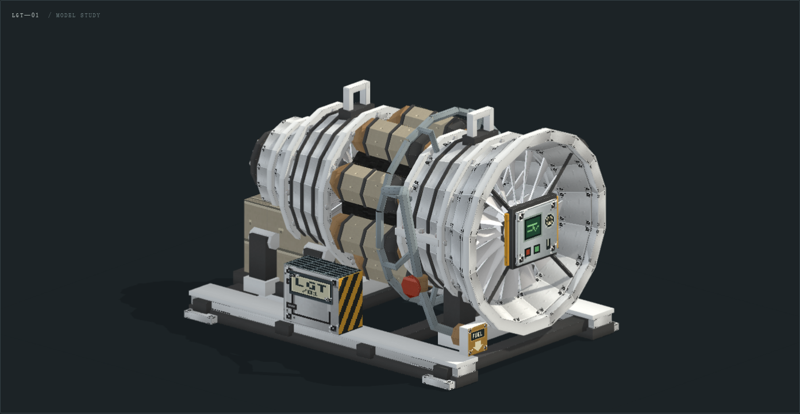

# 大型燃气涡轮

按 GT6CE 现有大型燃气轮机 **3×3×4 方块**结构制作的原创游戏模型。外观参考本地 HBM `turbinegas.obj` 的分段轴流机组、分筒燃烧室、厚法兰和像素金属语言。默认使用银色不锈钢机壳，另提供钛、钨钢、艾德曼合金配色；保留米灰保温层、外露燃料管与绿色 CRT 控制面板，金属面板具有明显的分层渐变和铆钉周围磨痕。

几何、UV 和贴图均由本项目生成器绘制，未复制 HBM 的模型或贴图。HBM 参考在 2026-11-02 读取自相邻 `Hbm-s-Nuclear-Tech-GIT` 工作副本，路径为 `src/main/resources/assets/hbm/models/machines/turbinegas.obj` 及对应贴图。

**游戏中使用低面版。** GT6CE 1.0.7 的四档原生大型燃气涡轮成型后，由控制器绘制 6,400 面 OBJ，并隐藏同一台机器已绑定的方块外壳。未成型或拆解时显示原生方块。结构、碰撞、燃料、排气和 RU 输出由 GT6CE 管理。

## 2026-11-02 本轮美术记录

本轮把首版偏蓝的机壳改成低饱和金属体系。默认不锈钢采用亮银，钛采用浅灰紫，钨钢采用深石墨，艾德曼合金采用略暖的珍珠银。四档只改变机壳图块，保温层、铜色燃烧筒、黄色警示、绿色 CRT 和仪表保持固定，避免整机换色后失去功能识别。

转子从机壳颜色中独立出来，使用 `rotor_body`、`rotor_edge`、`rotor_dark`、`rotor_hot` 四个中性灰图块。预览可以单独选择银白、石墨、钛灰、橄榄银或自定义颜色。游戏中从控制器档位读取宿主的转子材质，只染色 `rotor` 分组。

前面板增加银灰阶梯反光、绿色 CRT、模拟表和指示灯；铆钉图块加入局部亮点、暗边和少量碎屑噪点，保持像素细节但避免整面生锈。后侧在 RU 联轴器下方增加真正有深度的排气孔：带圆形凹腔、法兰螺栓和三根护栅，孔口与原排气箱后壁不重叠。

预览增加运行态美术演示：转子和联轴器绕 `(0,1.5,0)`、`+Z` 轴旋转，启动加速、停机惰转，燃烧段和涡轮热端按温度从暗红过渡到橙红，冷却时保留余温。控制项包括运行、暂停、复位、目标转速 `0–3600 RPM`、目标温度 `20–1200°C`；这些是预览参数，尚未绑定 GT6CE 的真实机器状态。

机壳配色、转子染色和热端辉光各自作用于对应分组，控制面板与接口的功能色保持稳定。



## 文件与查看

| 文件 | 用途 |
| --- | --- |
| `preview.html`（本地生成，不入库） | 自包含离线 WebGL 2 预览，无 CDN；视角、剖视、独立换色、启停、转速、温度、暂停与复位 |
| [large_gas_turbine.obj](large_gas_turbine.obj) | 完整模型，9,748 三角面、32 个命名部件，显式 UV 与法线 |
| [large_gas_turbine_cutaway.obj](large_gas_turbine_cutaway.obj) | 剖视版本，7,432 三角面、25 个部件；用于查看内部轴、五排叶片与燃烧内衬 |
| [large_gas_turbine_low_poly.obj](large_gas_turbine_low_poly.obj) | 低面试作，6,400 三角面、32 个命名部件，与完整模型共用图集 |
| `preview_low_poly.html`（本地生成） | 低面版交互预览，支持剖视、启动、停机惰转和热端辉光 |
| [preview_low_poly_animation.gif](preview_low_poly_animation.gif) | 低面版剖视转动 |
| [preview_low_poly_running.png](preview_low_poly_running.png)、[preview_low_poly_running_cutaway.png](preview_low_poly_running_cutaway.png) | 低面版 900°C 展示工况的整机和剖视截图 |
| [large_gas_turbine.mtl](large_gas_turbine.mtl) | 共用单图集的 Wavefront 材质 |
| [large_gas_turbine_atlas.png](large_gas_turbine_atlas.png) | 512×256 RGB 像素图集，32 个 64×64 材质块 |
| [large_gas_turbine_neutral_atlas.png](large_gas_turbine_neutral_atlas.png) | 机壳与转子使用中性灰，其他部分保持固定色，供后续动态染色使用 |
| [large_gas_turbine_tint_mask.png](large_gas_turbine_tint_mask.png) | 红通道标记机壳材质块，绿通道标记转子材质块，其余为黑 |
| [preview_variants.png](preview_variants.png) | 四档机壳配色对照；转子均保持默认银白 |
| [preview_animation.gif](preview_animation.gif) | 运行中剖视动画，包含转子旋转与热端辉光 |
| [preview_running.png](preview_running.png)、[preview_running_cutaway.png](preview_running_cutaway.png) | 900°C 展示工况的整机和内部截图 |
| [model.json](model.json) | 包围盒、分组、接口、控制器对齐与转子枢轴清单 |
| `preview*.png` | 全貌、正面、后面、侧面、俯视与剖视截图 |

导入 Blender 等工具时将 OBJ、MTL 和 PNG 放在同一目录。贴图采样使用 **Nearest / Closest / 最近邻**；32px 逻辑贴图以最近邻放大到 64px，保留像素边缘。完整模型与剖视模型是两个展示版本，不应叠放。

## 低面试作

| 绘制范围 | 完整版 | 低面版 |
| --- | ---: | ---: |
| 整机 | 9,748 | 6,400 |
| 预览剖视 | 7,432 | 4,932 |
| 随转角运动的转子与后联轴器 | 1,664 | 892 |
| 其中转子 | 1,328 | 636 |

低面版保留五排叶片，前端进气口可见的第一排仍为 16 片，后四排改为 12、10、10、8 片。叶片采用有厚度的楔形，叶根收进轮毂。管件端盖从外缘剖分，较细的紧固件和两段外壳减少周向分段，浅法兰省去埋在壳体内的内壁。低面剖视保留外露的八个燃烧筒和中央环形内衬。3×3×4 包络、接口对齐、转轴和各材质图集沿用完整版。

## 材质档位与转子换色

四档共用同一份几何和 UV，顺序依据宿主 `OriginalGeneratorParameters.java`。采用自调的低饱和金属色，原始 RGB 仅记录在 `model.json` 的 `source_rgb`，不代表这些贴图直接复制了原版颜色。

| 档位 | 外观 | 乘法调色 RGB | 可直接替换的图集 |
| --- | --- | --- | --- |
| 不锈钢 | 亮银，默认 | `225,228,228` | [stainless_steel.png](variants/stainless_steel.png) |
| 钛 | 浅灰紫 | `209,199,217` | [titanium.png](variants/titanium.png) |
| 钨钢 | 深石墨 | `120,126,129` | [tungsten_steel.png](variants/tungsten_steel.png) |
| 艾德曼合金 | 略带暖色的珍珠银 | `234,238,218` | [adamantium.png](variants/adamantium.png) |

导入后将材质的基础颜色贴图切换为对应图集即可换机壳，默认 OBJ/MTL 仍引用根目录不锈钢图集。所有档位的转子、管道、警示色、CRT 和仪表像素保持一致。

转子有四块专用中性灰贴图 `rotor_body`、`rotor_edge`、`rotor_dark`、`rotor_hot`，只有 `rotor` 分组使用。预览可选择银白、石墨、钛灰、橄榄银或自定义 RGB；机壳切换保留已选转子颜色。这些是美术演示颜色，没有新增转子物品或等级。

后续接入时，可从转子物品的材质读取 RGB，仅在绘制 `rotor` 时乘以 `RGB/255`，其他分组恢复白色乘数；默认转子乘数为 `#ffffff`。这与机壳等级独立。若使用完整中性图集，也可按遮罩红/绿通道分别给机壳和转子染色；已经上色的四档图集不应再重复叠乘机壳色。清单 `appearance` 和 `rotor` 记录了这些约定。

## 尺度与现有机器对齐

- 1 模型单位 = 1 方块；`+Y` 向上，前脸朝 `−Z`，机身向 `+Z` 延伸。
- 设计包络：`X=[−1.5,1.5]`、`Y=[0,3]`、`Z=[0,4]`。
- 实际包围盒：`(−1.42,0,0)` 至 `(1.47,2.74,4)`，外形 **2.89×2.74×4**。
- 底架接地 `Y=0`；主轴为 `X=0、Y=1.5`。
- 控制器方块中心在模型坐标 `(0,1.5,0.5)`，控制面板中心为 `(0,1.5,0)`。
- 默认朝北时，以控制器方块底角为渲染原点，OBJ 平移 **`(+0.5,−1,0)`**。其他朝向须绕控制器中心变换。

尺寸与角色依据 GT6CE 1.0.2 工作副本中的 `SharedTurbineStructure.java`、`StructureGrid.java` 和 `LargeGasTurbineControllerBlockEntity.java`：控制器居于前脸中央，35 个结构块补成实心 3×3×4。此处模型间隙是成型后外观，不改变实心结构要求。

| 视觉接口 | 模型坐标中心 | 朝向 | 控制器局部格 `(right,up,back)` |
| --- | --- | --- | --- |
| 中央控制面板 | `(0,1.5,0)` | `−Z` | `(0,0,0)` |
| 前侧燃料法兰 | `(1,0.5,0)` | `−Z` | `(1,−1,0)` |
| 底部排气法兰 | `(0,0,3.5)` | `−Y` | `(0,−1,3)` |
| 背面排气孔 | `(0,0.72,4)` | `+Z` | `(0,−1,3)` |
| 后端 RU 联轴器端面 | `(0,1.5,4)` | `+Z` | `(0,0,3)` |

燃料和排气法兰按水平放置时的方块面中心绘制。接管时按宿主规则使用前层燃料输入、世界最低层排气，以及后层中央 RU 输出。模型跟随控制器六向放置。竖向放置时，排气法兰随整机旋转，实际排气位置以世界最低层的宿主端口为准。

## 部件与剖视

主要结构为 `intake`、`compressor_shell`、`combustors`、`turbine_shell`、`rear_bearing`、`output_coupling`，由 `skid` 和 `mounts` 承托。八个燃烧筒围绕内衬分布，燃料环管连接前侧总管；热端下方接排气集箱。后壁的 `rear_exhaust` 是实际开孔，包含约 0.22 方块深的可见凹腔与螺栓法兰，`rear_exhaust_grille` 为三根实体护栅；排气孔位于 RU 联轴器下方，两者互不遮挡。

`rotor` 独立分组包含主轴和五排叶片，动画枢轴为 **`(0,1.5,0)`**，旋转轴为 **`+Z`**。预览中的 `output_coupling` 与转子同轴转动，其余分组保持固定；旋转变换同时作用于位置、法线与阴影。

剖视隐藏 `+X` 半侧的压气机壳、热端壳及法兰、右侧燃烧筒外壳和支管、侧面检修箱，保留内衬与转子。隐藏列表见 `model.json`；这是按部件隐藏的美术剖视，并非任意切面的实体 CAD。

游戏的 `ObjMesh` 读取三角面、`o/g` 分组及显式 `vt/vn`。四档共用低面 OBJ 的 VBO，每档绑定一张图集。普通世界渲染按热区和转动部件合为七批，`rotor` 和 `output_coupling` 使用同一转角。兼容路径使用 QUADS，将三角形提交为 `A,B,C,C`。

## 运行态展示

打开 `preview.html` 后勾选“运行”，机器从冷态逐渐加速和升温。取消“运行”后，转子惯性减速，热端保留余温并逐渐冷却。“暂停展示”冻结当前转角与温度，适合检查细节；“复位”回到停机冷态并恢复默认目标值，保留视角、剖视和材质选择。

- 目标转速：`0–3600 RPM`，默认 `1800 RPM`；目标温度：`20–1200°C`，默认 `900°C`。读数显示正在过渡的状态，不瞬间跳到目标。
- 为看清叶片，显示角速度为读数的 `0.02` 倍，例如 `1800 RPM` 显示为 `36 RPM`。界面标注“慢速展示”。
- 转速采用指数逼近，升速时间常数 `1.8 s`、减速 `3.5 s`；升温 `6 s`、冷却 `12 s`。按经过时间解析计算转角，普通帧率变化不改变动力学；长帧最多推进 `0.1 s`，切到后台暂停计时，回来不跳跃。
- 热辉光在展示温度 `450°C` 后逐渐出现，`1100°C` 达到最高强度，由暗红过渡到橙红。按部件权重和轴向位置集中于燃烧段、热端壳体及法兰；前端压气机、控制面板、底架与管线维持各自颜色。像素细节保留，冷态内部不会固定呈橙亮色。
- 换机壳或转子颜色不重置运行状态。冷却结束、暂停或页面隐藏时停止连续渲染，只有交互触发时重新绘制。

这些数值是 `model.json.animation` 中的美术预览参数。游戏用 GT6CE 同步的活动状态驱动加速、惰转和热端渐变，转速和热度仅供渲染。宿主按原有燃料批次和 RU 出力运行。

## 重新生成与检查

模型生成器是唯一输入，不手改 OBJ、MTL、图集、清单或预览 HTML。源脚本按仓库约定存放于被忽略的本地 `scripts/models/`：

- `build_gas_turbine.py`：几何、OBJ/MTL、清单与预览导出；复用 `build_fluidized_bed.py` 的盒体、管件等基础几何方法。
- `gas_turbine_materials.py`：确定性的原创像素图集，依赖 Pillow。
- `gas_turbine_viewer.html`：预览模板，使用 `viewer_shell.css`。
- `gas_turbine_animation.js`：预览启停、惯性和温度状态；生成时内嵌到 HTML，无外部请求。
- `inspect_gas_turbine.py`：本地截图与交互检查，依赖 Python Playwright 及 Chromium。
- `inspect_gas_turbine_animation.py`：真实 WebGL 动画、热着色和控制器检查；`--gif` 额外生成循环动图。

在项目根目录执行：

```powershell
python scripts/models/build_gas_turbine.py
python scripts/models/inspect_gas_turbine.py
python scripts/models/inspect_gas_turbine_animation.py --gif
python scripts/models/inspect_gas_turbine_animation.py --low-poly --gif
```

第二条命令更新六视图、四档预览及对照图、独立转子换色示例，并将交互检查报告、736/360 像素布局截图写入 `build/gas-turbine-qa/`。需要更新美术时，保留这组本地源脚本及其依赖。

第三条命令更新运行态截图和动图，报告为 `build/gas-turbine-qa/animation_report.json`。动画检查既通过显式步进验证长时间冷却，也通过浏览器真实帧时钟验证启动、暂停与继续；固定转角比较冷态、400°C 与 1200°C 像素，避免把叶片转动误判为温度着色。

第四条命令对低面版执行同样的检查，运行态截图和动图使用 `preview_low_poly_` 前缀，报告写入 `build/gas-turbine-qa/low-poly/animation_report.json`。

更新游戏资源时，在生成模型后执行 `python scripts/models/install_gas_turbine.py`。安装器将低面 OBJ 和四档图集复制到两端共用资源。用 `scripts/build.ps1 :forge:gasTurbineRenderTest :neoforge:gasTurbineRenderTest` 检查顶点流、六向包围盒、染色和启停插值。

2026-11-02 验证：两条命令通过；检查覆盖有限坐标、UV 范围、单位法线、非退化三角面、绕序、3×3×4 包络，以及 WebGL 背面剔除、贴图、五视角、剖视、网格、高亮、拖动、缩放和窄屏布局。四档图集的非机壳像素一致，转子贴图为独立灰度块；预设与自定义转子换色、切换机壳保留转子颜色均通过。另直接解析导出 OBJ，确认索引、四舍五入后的法线/绕序、MTL 引用及统计一致，并检查后排气孔深度、法线和相邻结构间隙。

同日运行态追加验证：状态模块整段与分帧推进一致，启停与冷却、输入边界通过；动画检查命令通过真实浏览器的运行控件、转速/温度滑杆、暂停/继续、停机余温、复位保留场景、换色保留状态、热着色像素差异及 720/360 像素布局。没有页面、控制台或 WebGL 错误。

2026-11-02 的验证覆盖美术预览。游戏接入后的双端渲染检查由 `gasTurbineRenderTest` 执行。

2026-11-12 使用 GT6CE 1.0.7 和 NeoForge 1.21.1 隔离客户端验证了四档、六向成型、绑定外壳隐藏、原生燃料驱动的叶轮转动和拆解后的方块模型恢复。独立放置的同材质外壳保持可见。

Forge 1.20.1 通过完整构建与顶点检查。隔离客户端完成贴图加载，日志确认转子渲染、包围盒和相邻面 Mixin 已应用。Forge 进世界后的成型与拆解仍待验证。
