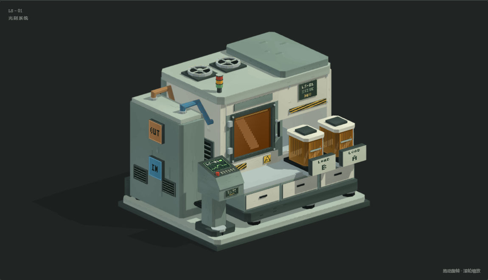
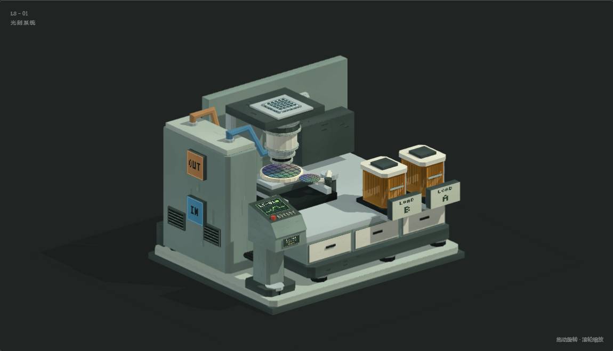

# 光刻机 LS–01

参考 HBM 的厚钣金、灰绿工业配色、深色接缝与像素仪表制作的原创多方块美术资产。机器由封闭曝光舱、双晶圆装载台、侧置控制台和独立公用工程柜组成，搭配少量黄黑警示条、琥珀色晶圆匣与观察窗。

**宽 5 × 深 4 × 高 4 方块，38 个具名部件，4,836 个三角面。** 尚未接入游戏的多方块结构、碰撞、接口或渲染，不改变现有光刻配方和机器行为。



## 文件

| 文件 | 内容 |
| --- | --- |
| [lithography_machine.obj](lithography_machine.obj) | 完整模型；三角面、平面法线、具名 `o` / `g` 分组 |
| [lithography_machine_cutaway.obj](lithography_machine_cutaway.obj) | 移除前部、左右舱壁与顶盖的剖视模型 |
| [lithography_machine.mtl](lithography_machine.mtl) | 两份 OBJ 共用的单材质定义 |
| [lithography_machine_atlas.png](lithography_machine_atlas.png) | 512×256 RGB 像素图集；最近邻过滤 |
| `preview.html`（本地生成，不入库） | 内嵌网格与贴图的离线 WebGL 2 预览，无 CDN 或网络依赖 |
| [model.json](model.json) | 尺寸、分组、接口、控制器参考位置和剖视隐藏列表 |
| [preview_cutaway.png](preview_cutaway.png) | 内部结构预览 |
| [preview_front.png](preview_front.png)、[preview_back.png](preview_back.png)、[preview_side.png](preview_side.png)、[preview_top.png](preview_top.png) | 正面、背面、右侧和俯视 |

导入时将 OBJ、MTL 和 PNG 放在同一目录，保持文件名不变。使用最近邻纹理过滤、平面着色和背面剔除；模型不依赖透明排序或多材质。观察窗采用不透明琥珀色像素贴图，内部通过独立剖视版本查看。

预览支持拖动旋转、滚轮缩放、五个视角、剖视、方块地面网格和部件高亮。键盘方向键旋转，`+` / `-` 缩放，`Home` 复位。当前为静态模型，OBJ 不包含动画。

## 内部构造与坐标



内部包括独立的多级投影镜筒、掩模版定位台、XY 晶圆台、曝光位晶圆、晶圆搬运机械臂和封闭光路。采用 DUV 镜筒式设备的游戏美术示意，不对应真实设备的工程尺寸或光学设计。

1 OBJ 单位 = 1 方块，`+Y` 向上，`-Z` 为正面，原点位于整体包络的最小角。所有几何限定在 `(0,0,0)` 至 `(5,4,4)` 内。以下为预留的美术接口，其中心对齐方块外表面：

| 接口 | 方块格 `(X,Y,Z)` | 外表面中心 | 朝向 | 分组 |
| --- | --- | --- | --- | --- |
| 晶圆装载 A | `(0,1,0)` | `(0.5,1.5,0)` | `-Z` | `load_ports` |
| 晶圆装载 B | `(1,1,0)` | `(1.5,1.5,0)` | `-Z` | `load_ports` |
| 控制台 | `(4,1,0)` | `(4.5,1.5,0)` | `-Z` | `control_console` |
| EU 输入 | `(4,0,3)` | `(4.5,0.5,4)` | `+Z` | `eu_input` |
| 氮气输入 | `(0,1,3)` | `(0.5,1.5,4)` | `+Z` | `nitrogen_input` |
| 冷却液输入 | `(4,1,2)` | `(5,1.5,2.5)` | `+X` | `coolant_input` |
| 冷却液回流 | `(4,2,2)` | `(5,2.5,2.5)` | `+X` | `coolant_return` |

朝北放置时，以控制器方块最小角为渲染原点，模型平移 `(-4,-1,0)`；其余方向绕控制器方块中心旋转。这只是后续接入所需的坐标约定，游戏尚未采用这些接口。

## 参考、生成与检查

造型参考为本机 `Hbm-s-Nuclear-Tech-GIT` 的 `silex.obj`、`assembly_machine.obj`、`exposure_chamber.obj` 与对应贴图；公开项目见 [Hbm's Nuclear Tech Mod](https://github.com/HbmMods/Hbm-s-Nuclear-Tech-GIT)。模型与贴图全部由本地脚本重新生成，生成过程不加载或复制 HBM 的网格、UV 或贴图。

在仓库根目录执行，生成需要 Python 3 和 Pillow；浏览器检查另需 Playwright 及 Chromium：

```powershell
python scripts/models/build_lithography_machine.py
python scripts/models/inspect_lithography_machine.py
# 仅检查导出的几何、材质、包络与接口：
python scripts/models/inspect_lithography_machine.py --geometry-only
```

生成输入为 `scripts/models/build_lithography_machine.py`、`lithography_machine_materials.py` 与 `lithography_machine_viewer.html`；复用同目录 `build_fluidized_bed.py` 的几何原语、`irradiation_reactor_materials.py` 的基础字形及 `viewer_shell.css`。**修改生成输入后重新导出，不手改产物。** `scripts/models/` 按仓库约定被忽略，仅在当前工作副本中维护；仅克隆仓库的产物不能重建模型。

独立检查解析 OBJ/MTL，核对索引、有限坐标、单位法线、UV 范围、退化面、绕序、相对资源引用、完整/剖视组一致性、尺寸与接口方块中心；浏览器检查覆盖贴图、截图、视角、剖视、网格、部件选择、鼠标键盘与窄屏布局。报告写入 `build/lithography-machine-qa/report.json`。

2026-11-03：上述生成和完整检查命令已通过，25 项检查成功，生成六张实际 WebGL 截图；没有页面、控制台或 WebGL 错误，没有外部网络请求。人工检查了全貌、剖视及各正交视图，修正了顶盖 UV 拉伸和剖视时外壳附件悬空的问题。

本次只制作美术资产，不需要 Java 构建。Forge / NeoForge 游戏内加载、实际光照、碰撞、交互与机器行为均待接入后验证。
