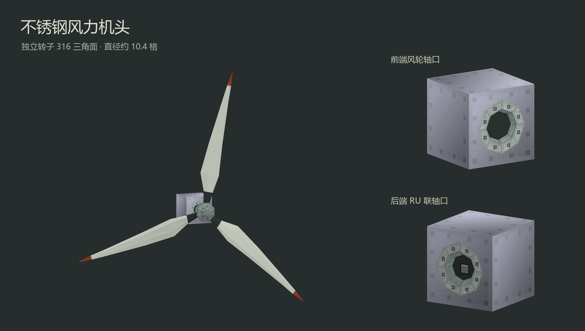

# 工业风力机低面版

机头使用单方块不锈钢机器外壳。前端是风轮轴口，后端是 RU 联轴口。两个口均为内凹结构。三片闭合叶片保留渐缩、扭转与红色叶尖，轮毂和法兰的紧固件绘入像素图集。

机头 112 三角面，转子 316 三角面，合计 428 面。

- [组合 OBJ](wind_turbine_low_poly.obj)、[静态机头](wind_turbine_head.obj)、[独立转子](wind_turbine_rotor.obj)
- [MTL](wind_turbine_low_poly.mtl)、[图集](wind_turbine_low_poly_atlas.png)与 OBJ 放在同一目录，贴图用最近邻采样。
- [模型数据](model.json)记录枢轴、扫掠范围和 RU 接口坐标。

1 单位 = 1 方块。以机头方块底角为原点，+Y 向上，−Z 为前。转子枢轴 `(0.5, 0.5, -0.55)`，绕 `+Z` 旋转，直径约 10.4 格。

外壳使用相邻 GT6CE 检出的 `block/material_icons/metallic/casingmachine.png` 和 `casingmachine_overlay.png`。底图按宿主不锈钢色 `#C8C8DC` 染色，叠层保持原色。GT6CE 的 NOTICE 将上游默认贴图标为 CC0-1.0。

在仓库根目录运行 `python scripts/models/build_wind_turbine_low_poly.py` 重新生成。生成器从相邻 `GregTech6CommunityEdition/GregTech6` 读取上述外壳原图。

运行 `python scripts/models/build_wind_turbine_low_poly.py --install` 生成并安装运行时资源；`--install-only` 只安装已经生成的资源。机头使用两端各自的原生 OBJ 加载器烘焙，转子由共用客户端渲染器绘制；资源安装不代表游戏内验收完成。
