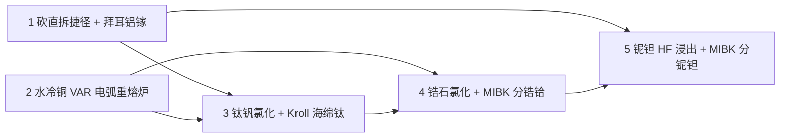
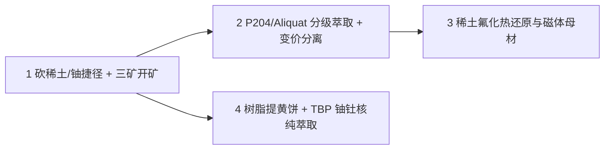
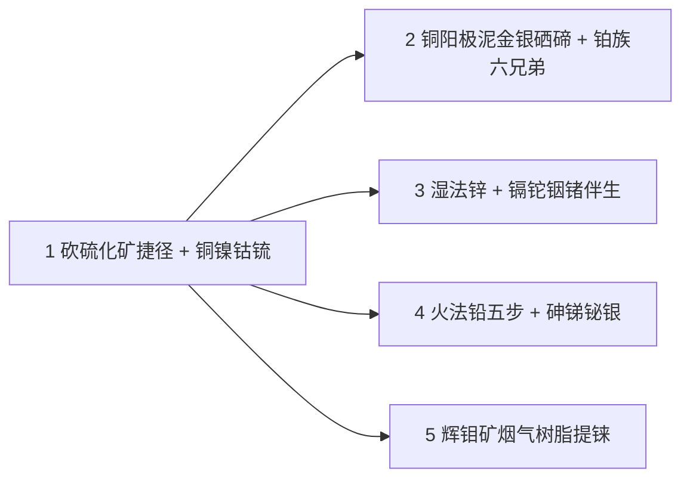
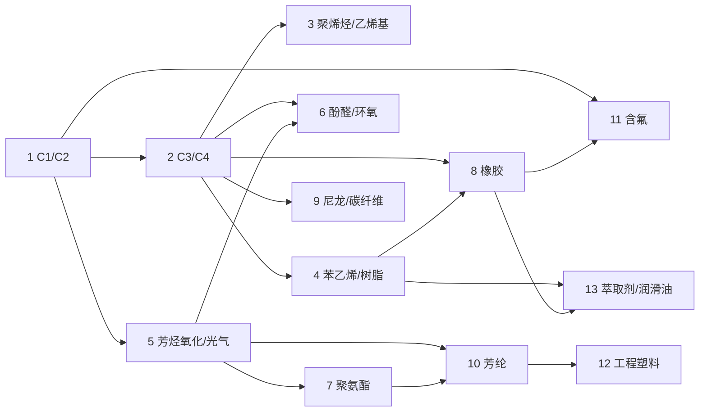

# `ssite` 计划卡总览

依据是 [`docs/supersymmetry-ssite-plan.md`](../supersymmetry-ssite-plan.md) 的里程碑路线图。

- **第一阶段（M0–M4 · 基础、不锈钢、纯水卤水、石化与高分子产出）**：**已全部完成**（见文档下半部分归档区）。
- **第二阶段（M5–M9 · 大冶金时代、伴生分离网、唱片工业与下游挂载）**：**M5（活泼与难熔金属）已完成并归档**；**M6（湿法萃取：稀土与铀钍）第 1 张卡已关闭，第 2–4 张待实现**；之后按 **M7（有色主金属、铂族与伴生渣网） $\rightarrow$ M8（化工音乐唱片） $\rightarrow$ M9（石化与高纯材料下游消纳）** 顺序推进。

还没有对外发布过，不做旧存档迁移。

---

## M5 卡（已完成 · 活泼与难熔金属篇：「钛铝锆也没那么容易」）

```text
lane            = closed
slug            = m5/index
```

M5 旨在堵住 GT6CE `DecompositionRecipeLoader` 与 `GTChemGen` 中将 `Bauxite`、`Zircon`、`Coltan`、`Columbite`、`Tantalite` 直接离心拆解、将 `Alumina`、`Rutile`、`Ilmenite`、`Nb2O5`、`Ta2O5` 直接电解出金属单质、以及 `Bath` 中 0 电耗还原 $\text{TiCl}_4$ 的捷径；建立 **铝（伴生镓）、镁-氯循环、钛（伴生钒）、锆与铪、铌与钽** 五大产线，并实装专属 **水冷铜电弧重熔炉（`ssite:var_furnace`）**，一举打通 M1 全六档 AOD 转炉（含铌钛 `NiobiumTitanium` 与碳化钽铪 `TantalumHafniumCarbide` $\text{Ta}_4\text{HfC}_5$）的生存闭环。

**核心设计约定**：

1. **海绵金属锁死敞口坩埚**：Kroll 镁热还原产出的 `TitaniumSponge`（海绵钛）、`ZirconiumSponge`（海绵锆）、`HafniumSponge`（海绵铪）仅注册为 `.dust()`（不声明 `.metal()`，无 `MELTING` 属性），无法在普通敞口坩埚熔化或直接压锭；
2. **水冷铜电弧重熔炉（`ssite:var_furnace`）**：复用 `AodConverterCore` 的 \(1\times 1\times 2\) 架构与顶部 `ssite:aod_lid` 炉盖，仅 1 种水冷铜材质（1 套贴图），接入 `EU`（电弧升温）与单流体槽 `Argon`（关盖锁气保护），无熔点烧穿上限；负责将海绵钛/锆/铪重熔为液态 `Titanium`/`Zirconium`/`Hafnium` 并经原版浇铸口（`Faucet`）浇铸成锭，同时支持在氩气下电弧熔炼 `NiobiumTitanium` 与 $\text{Ta}_4\text{HfC}_5$；
3. **M4 萃取剂上岗**：锆/铪分离与铌/钽分离统一使用 M4 第 13 卡实装的 `MIBK`（甲基异丁基酮）萃取剂，在 `mixer`（萃取与反萃）+ `centrifuge`（分相，有机相循环）中完成；离心机只有 1 个流体输入槽，需要两路流体的反萃步改用 `mixer`。

| 顺序 | 状态 | 卡 | 做完能看到什么 |
|---|---|---|---|
| 1 | 已关闭 | [`砍掉矿石/氧化物直拆捷径与拜耳法铝镓闭环`](closed/拜耳法铝镓与直拆捷径移除详细计划.md) | 移除 `Bauxite`/`Zircon`/`Coltan`/`Columbite`/`Tantalite` 离心直拆与 `Alumina`/`Rutile`/`Ilmenite`/`Nb2O5`/`Ta2O5`/`VitriolOfClay` 直接电解；补完拜耳法产出赤泥（`RedMud`）与种分母液提半导体级金属镓（`Gallium`）；修复原版缺失的氟化铝（`AlF3`）并梳理冰晶石熔盐电解铝闭环 |
| 2 | 已关闭 | [`水冷铜电弧重熔炉（ssite:var_furnace）`](closed/水冷铜电弧重熔炉详细计划.md) | 实装 \(1\times 1\times 2\) 水冷铜 VAR 电弧炉（复用 `ssite:aod_lid` 炉盖，接 `EU` + 侧面单槽 `Argon`）与 `ssite.recipe.var` 展示表；注册海绵钛/锆/铪（`.dust()`，锁死普通坩埚）；支持海绵金属重熔浇铸及 `NiobiumTitanium`、$\text{Ta}_4\text{HfC}_5$ 超高温电弧合金化 |
| 3 | 已关闭 | [`金红石/钛铁矿氯化、除钒精馏与 Kroll 海绵钛闭环`](closed/钛钒氯化与海绵钛详细计划.md) | 移除 `Bath` 0 电耗还原钛与 `BurnMixer` 直出纯 $\text{TiCl}_4$；钛铁矿/金红石氯化出粗 $\text{TiCl}_4$，精馏分离三氯氧钒（$\text{VOCl}_3 \rightarrow \text{V}_2\text{O}_5 \rightarrow \text{V}$）；纯 $\text{TiCl}_4 + \text{Mg} \rightarrow$ 海绵钛（`TitaniumSponge`）+ $\text{MgCl}_2$（电解再生镁与氯气闭环） |
| 4 | 已关闭 | [`锆石氯化、MIBK 锆铪萃取分离与 Kroll 海绵锆/铪`](closed/锆石氯化与锆铪分离详细计划.md) | 锆石碳热氯化得含铪粗 $\text{ZrCl}_4$（副产 $\text{SiCl}_4$ 水解回二氧化硅）；氯氧化锆溶液经 `MIBK` 萃取拆出纯二氧化锆与二氧化铪（`MIBK` 95% 循环再生）；二次氯化 + 镁热还原得海绵锆（`ZirconiumSponge`）与海绵铪（`HafniumSponge`），进 VAR 重熔成锭 |
| 5 | 已关闭 | [`铌钽矿 HF 浸出、MIBK 萃取拆分与 AOD 终极材料闭环`](closed/铌钽浸出萃取与AOD终极闭环详细计划.md) | `Coltan`/`Columbite`/`Tantalite` 经 $\text{HF}+\text{H}_2\text{SO}_4$ 浸出得氟铌钽酸混液；`MIBK` 分步萃取拆出氟钽酸钾（`K2TaF7` 钠热还原得钽）与五氧化二铌（`Nb2O5` 铝热还原得铌）；全线打通 M1 六档 AOD 转炉材料闭环 |

依赖关系：



> **结果（2026-10-23）**：五张卡全部实现并关闭。Forge/NeoForge 双加载器 `build` 通过；NeoForge 开发服务器启动至 `Done`，新增配方与展示行 0 拒绝、移除规则 0 拒绝；客户端实测 Ti/Zr 产线的 EMI 显示正确。计划卡已归档到 `closed/`。
>
> **实现偏差**：
> 1. 富铪相反萃从 `centrifuge` 改为 `mixer`（离心机只有 1 个流体输入槽），配方数值不变。
> 2. Hall–Héroult 电解铝只保留 `Carbon` 阳极行：`CoalCoke` 自带一条电解分解配方，会与新增行的输入发生碰撞而被拒绝。

---

## M6 卡（第 1 张已关闭 · 第 2–4 张待实现 · 湿法萃取篇：稀土三矿全分离与铀钍前段）

```text
lane            = planned
slug            = m6/index
```

**针对的 GT6CE 原版漏洞**：
- `GTOresGen` 中 `RareEarth` 进离心机（按形态 16–144 EU/t）直接甩出 `Nd`、`Y`、`La`、`Ce`、`Cd`（镉）、`Cs`（铯）；
- `Bastnasite`（氟碳铈矿）进电解机直接出 `Ce + C + F + O`，或丢进坩埚每块矿化出 `U/9` 金属铈；
- `Pitchblende`（沥青铀矿）离心机直接拆出 `Uraninite + Th + Pb`；`Uraninite`/`Pitchblende` 进坩埚分别化出 `U/3` 与 `U/5` 的 `U-238`（本版本没有 `Uraninite` 电解行）。

**核心设计约定**：
1. 全面复用 GT6CE 内置 `bath`（酸浸/碱转）、`calciner`（焙烧）、`mixer`（溶剂萃取）+ `centrifuge`（澄清分相与反萃，有机相循环不消耗），**零新增机器**；
2. 让 M4 第 4 卡与第 13 卡备好的 **`P204`**、**`TBP`**、**`Aliquat 336`**、**`三辛胺`** 与 **`强酸/强碱离子交换树脂`** 全员上岗；
3. 稀土金属化统一走「氧化物 $\xrightarrow{+\text{HF}}$ 无水氟化物 $\xrightarrow{+\text{Ca / Li}}$ 稀土金属 + $\text{CaF}_2$」。

| 顺序 | 状态 | 卡 | 做完能看到什么 |
|---|---|---|---|
| 1 | 已关闭 | [`砍掉稀土/铀矿直拆捷径与三矿浸出分群`](closed/稀土三矿开矿与直拆捷径移除详细计划.md) | 移除 `RareEarth`/`Pitchblende` 离心直拆与 `Monazite`/`Bastnasite` 电解；实装氟碳铈矿（焙烧脱氟酸浸）、独居石（酸浸优先分出钍饼与铀酰液）、磷钇矿（碱熔酸浸）三矿开矿，统一产出混合稀土母液。坩埚直熔移除为 GT6CE 侧已知缺口 |
| 2 | 已开卡 | [`稀土 P204 / Aliquat 336 分级萃取与变价分离`](稀土P204与Aliquat336分级萃取详细计划.md) | 用 `P204` 将混合稀土切分为**轻稀土（La-Ce-Pr-Nd）**、**中稀土（Sm-Eu-Gd）**、**重稀土（Tb-Dy-Y-Lu）**三段；结合 **$\text{Ce}^{4+}$ 氧化沉淀**与 **$\text{Eu}^{2+}$ 锌还原**变价技巧，配合 `Aliquat 336` 拆分出各单一稀土氧化物 |
| 3 | 已开卡 | [`稀土氟化钙热还原与特种晶石/磁体母材`](稀土氟化钙热还原与磁体母材详细计划.md) | 各稀土氧化物氟化后用钙/锂热还原得金属单质（La, Ce, Pr, Nd, Sm, Eu, Gd, Y 等）；接通钐钴（`SmCo`）、钕铁硼（`NdFeB`）、钇钡铜氧（`YBCO`）与掺钕 YAG 的前置材料 |
| 4 | 已开卡 | [`铀钍钒湿法前段与 TBP 核纯萃取`](铀钍TBP核纯萃取与黄饼详细计划.md) | 沥青铀矿/晶质铀矿氧化酸浸 $\rightarrow$ M4 **强碱阴离子交换树脂**吸附洗脱得重铀酸铵（黄饼 `Yellowcake`）；独居石钍渣与黄饼分别经硝酸溶解 + **`TBP` 萃取反萃**得核纯硝酸钍（$\rightarrow \text{ThO}_2 / \text{Th}$）与硝酸铀酰（$\rightarrow \text{UO}_2 \rightarrow \text{UF}_4$） |

依赖关系：



> **开卡说明（2026-10-24）**：
> 1. **磷钇矿是新增矿石**：GT6CE 没有 `Xenotime` 材料与矿脉；第 1 张卡注册新矿石 + 主世界矿脉（`xenotime`，Y 0–30），矿石/粉尘贴图由 GT6CE 自动生成。
> 2. **坩埚直熔需要 GT6CE 侧新增移除入口**：`Bastnasite -> U/9 Ce`、`Uraninite -> U/3 U-238`、`Pitchblende -> U/5 U-238` 写在 `setSmelting` 里，现有 addon API 只能改本 addon 自己的材料；第 1 张卡把 GT6CE 的 `smeltingTargetRemovals()` 列为跨仓库前置，未落地时该项记为已知缺口。
> 3. **修正两处总览描述**：`Monazite` 的原版捷径是电解机（不是离心机）；`Uraninite` 在本版本没有通用电解行，实际捷径是坩埚熔炼与选矿链。
> 4. **不新增机器**：四张卡全部落在 GT6CE 内置 `bath` / `calciner` / `mixer` / `centrifuge` / `autoclave` / `electrolyzer` 上，**没有新机器贴图**。
> 5. **磁体材料**：第 3 张卡新建 `NeodymiumIronBoron`，不复用 GT6CE 的 `NeodymiumMagnetic`（后者的内置组分只有 `Nd`，坩埚能直接从钕粉化出磁体）。GT6CE 老磁体暂不删除，M9 再把电机配方改吃新磁体。
> 6. **第 4 张卡的「钒」不扩链**：钒已在 M5 钛钒氯化卡闭环，本卡只做铀钍前段。

> **收卡说明（2026-10-24）**：第 1 张卡已完成并移入 `closed/`。双加载器 `compileBoth` 通过，8 条移除规则加载后 `rejected 0`，NeoForge 服务端启动至 `Done (19.529s)`。为适配 GT6CE 当前 API，`ArgonCrucibleBehavior` 的 `fillMoldAtSide` 已改为 `Direction`。
> **缺口**：GT6CE 分支 `RecipeMap` 本身缺少 5 参数 `addMade` 重载，双版运行 JAR 无法重建；坩埚直熔移除的 API 与调用虽已写入 GT6CE 工作区，但本次运行验证使用旧 JAR，`Bastnasite` / `Uraninite` / `Pitchblende` 仍会熔出金属。

---

## M7 卡（待排期 · 有色主金属篇：铜镍锍、铂族六兄弟与铅锌伴生渣网）

```text
lane            = planned
slug            = m7/index
```

**针对的 GT6CE 原版漏洞**：
- 所有硫化矿（`Chalcopyrite` 黄铜矿、`Pentlandite` 镍黄铁矿、`Sphalerite` 闪锌矿、`Galena` 方铅矿、`Molybdenite` 辉钼矿、`Cooperite` 硫铂矿、`Sperrylite` 砷铂矿、`Stibnite` 辉锑矿）不仅能用电解机（64 EU/t）常温直接拆出纯金属+硫粉，还能直接丢进普通坩埚化出金属单质；
- `GTChemGen` 的焙烧炉（`Roasting`）把硫化矿 + 氧气一步直接烧成纯金属粉（如 `Sphalerite + O2 -> Zn`，`Cooperite + O2 -> Pt + Ni + Pd`）；
- `PlatinumGroupSludge`（铂族泥）进离心机（64 EU/t）一步甩出 `Pt / Pd / Rh / Ir / Ru / Os` 六种铂族金属；
- 稀散元素（铟 `In`、锗 `Ge`、镉 `Cd`、铊 `Tl`、硒 `Se`、碲 `Te`、铼 `Re`、铋 `Bi`）缺乏真实的工业伴生出口。

**核心设计约定**：
1. **主金属决定伴生出口**：不给稀散元素编造假矿，玩家在精炼铜、镍、铅、锌、钼时，从阳极泥、烟道灰、浸出渣里把贵金属与稀散元素捞出来；
2. 砍掉硫化矿电解直拆、坩埚直熔硫化矿、以及一步焙烧出金属的捷径，还原「硫化矿焙烧成氧化物/锍 $\rightarrow$ 火法还原或湿法电积」的经典冶金逻辑。

| 顺序 | 状态 | 卡 | 做完能看到什么 |
|---|---|---|---|
| 1 | 待开卡 | 砍掉硫化矿直拆/直熔捷径与铜镍钴锍前段 | 移除硫化矿常温电解、一步焙烧出单质与铂族泥离心直拆；黄铜矿/镍黄铁矿熔炼造**冰铜/绿锍（`GreenMatte`）** $\rightarrow$ 吹炼**白锍（`WhiteMatte`）**；白锍浸出分离硫酸镍钴（`P204` 拆镍钴）与粗铜，粗铜电解精炼产出高纯阴极铜 + **铜阳极泥（`CopperAnodeSlime`）** + **铂族精矿** |
| 2 | 待开卡 | 铜阳极泥金银硒碲回收与铂族六兄弟氯络合分离 | 铜阳极泥氧化焙烧蒸出二氧化硒/二氧化碲（$\text{SO}_2$ 还原得半导体级 **硒 `Selenium` / 碲 `Tellurium`**），分金银得粗银与氯金酸（草酸还原高纯金）；铂族精矿与硫铂矿/砷铂矿王水溶解，经四氧化锇/钌蒸馏、氯化铵沉铂、氨络合沉钯、六氯铱酸铵沉铱，完整拆出 **Pt / Pd / Rh / Ir / Ru / Os** 六兄弟 |
| 3 | 待开卡 | 闪锌矿焙烧湿法炼锌与镉、铊、铟、锗伴生链 | 闪锌矿焙烧得氧化锌焙砂（`Zincite`）+ **富镉铊烟尘**（酸浸锌粉置换得**镉 `Cadmium`** 与**铊 `Thallium`**）；焙砂硫酸浸出电积得锌，**浸出渣**盐酸溶解后经 **`TBP` 萃取提铟（`Indium`）**、氯化蒸馏水解提半导体级 **锗（`Germanium`）** |
| 4 | 待开卡 | 方铅矿火法五步精炼与砷、锑、铋、银回收 | 方铅矿烧结还原得粗铅；依次经除铜浮渣、**哈里斯碱熔软化（回收砷 `Arsenic` / 锑 `Antimony`）**、**帕克斯加锌脱银（回收银 `Silver`）**、**克罗尔-贝特顿钙镁脱铋（回收铋 `Bismuth`）**得精铅 |
| 5 | 待开卡 | 辉钼矿焙烧烟气离子交换提铼与钨钼高纯闭环 | 辉钼矿焙烧产出三氧化钼（`MoO3`，氨溶氢还原得高纯钼）与**含铼烟气**；烟气水洗后用 M4 **弱碱性阴离子交换树脂**吸附、氨水洗脱结晶得高铼酸铵（`AmmoniumPerrhenate`），氢还原得超合金核心元素 **铼（`Rhenium`）** |

依赖关系：



---

## M8 卡（待排期 · 彩蛋支线：化工音乐唱片工业）

```text
lane            = planned
slug            = m8/index
```

把 M3/M4 产出的 PVC、PVAc、炭黑、聚碳酸酯、邻苯二甲酸酐，以及 M7 产出的高纯银、镍、金直接变成游戏里能放进唱片机听歌的自定义音乐唱片！

| 顺序 | 状态 | 卡 | 做完能看到什么 |
|---|---|---|---|
| 1 | 待开卡 | 复古黑胶唱片线（母盘刻纹、镍电铸压模与黑胶批量压盘） | `PVC + PVAc + 炭黑 + 硬脂酸盐` 混炼压制空白黑胶盘；铝板涂硝化纤维素漆刻纹 + 硝酸银敏化镍电铸得不消耗的 `#n 镍压模`；压机批量压出自定义黑胶唱片 |
| 2 | 待开卡 | 现代激光刻录光盘线（酞菁染料、银反射层与 CD-R 激光刻录） | 苯酐 + 尿素 + 铜盐合成 `酞菁染料`；光学级聚碳酸酯注塑盘基 + 酞菁记录层 + 银箔/金箔反射层 + 丙烯酸保护漆组装 `空白 CD-R`；激光雕刻机按电路号一步刻录光盘 |

---

## M9 卡（远期规划 · 下游挂载与电子/结构材料消纳篇）

```text
lane            = planned
slug            = m9/index
```

等 M1–M7 的所有高分子、超纯水、高纯稀散金属、贵金属、难熔金属全部就位后，按模块分批挂载下游消耗配方（需要新物品贴图的模块集中在这一阶段按需制作）：

| 顺序 | 状态 | 卡 | 做完能看到什么 |
|---|---|---|---|
| 1 | 待开卡 | 工业公用耗材挂载（润滑油、变压器油、线缆橡胶与钻井/切割液） | 无需新物品贴图：多氯联苯（`PCB`）合成与高压变压器绝缘油；`PAO` / 聚异丁烯调合高级润滑油；五大合成橡胶与 `PVC`/`PTFE`/`FEP` 挂载至各级线缆绝缘包覆 |
| 2 | 待开卡 | 电路基板世代升级（酚醛纸板 $\rightarrow$ G10 $\rightarrow$ FR-4 $\rightarrow$ Kapton） | 铜箔电沉积、过硫酸钠/氯化铁蚀刻液、脂环族环氧阻焊绿油；用酚醛、普通环氧玻纤板、四溴阻燃环氧玻纤板、聚酰亚胺薄膜分代替换 MV–IV 电路基板 |
| 3 | 待开卡 | 高纯硅锗晶圆、III-V 族化合物半导体与光刻胶楼梯 | 三氯氢硅西门子法多晶硅、高纯锗、砷化镓（`GaAs`）/ 磷化铟（`InP`）单晶；重氮萘醌-酚醛 / PMMA / KrF 光刻胶与超纯水（`UltrapureWater`）清洗刻蚀链 |
| 4 | 待开卡 | 储能电池、燃料电池膜电极与特种功能部件 | `PVDF` 粘结剂与锂/镍氢电池；`Nafion` 质子交换膜 + `PTFE` 碳纤维气体扩散层 + `Viton` 密封圈组装燃料电池与全钒液流电池（消化 M5 钒） |
| 5 | 待开卡 | 防弹护甲、宇航服织物与高温合金精密失蜡铸造 | 凯夫拉 / 诺梅克斯 / `UHMWPE` / 镀铝 `Mylar` / `EVA` 液冷管防护服；氢化石油树脂 + 交联 PS 珠配制失蜡铸造模壳，浇铸含铼（`Re`）单晶高温合金涡轮叶片 |

---

# 第一阶段已归档里程碑（M1–M4）

## M4 卡（已完成）

```text
lane            = closed
slug            = m4/index
```

第 1～13 张已关闭并归档至 `docs/card-plans/closed/`。

M4「纯石化下游：四大高分子与精细化学品」第一阶段**只做产出**：每种高分子都能合成、能成型（粉 / 板 / 箔 / 细线 / 锭），但不改任何 GT6 原版配方去消耗它们。消耗端统一留到 M9（原 M6）。

**代码骨架**由第 1 张卡建立，之后各卡都沿用：

- M4 材料全部放进新类 `material/PolymerMaterials`，由 `SsiteMaterials` 拼接；
- 配方全部放进新类 `chemistry/PolymerRecipes`，由 `ChemistryRecipes.add` 在 `PetrochemRecipes.add()` 之后调用；
- 聚合物统一用 `polymerForming` 成型：压板（电路 1）、轧箔，有 `wires()` 的再加拉细线。这个 helper 在第 3 张卡里建立。

**约定**：

1. 同一台机器上如果一条配方的输入是另一条的子集，用编程电路区分，电路一律不消耗；
2. 约 `1000 mB` 单体对应 `1 × dust` 聚合物；
3. 引发剂统一用 M3 的异丙苯过氧化氢（`10 mB`），含氟单体例外，用过硫酸钠；
4. 乳液 / 悬浮聚合统一用 M2 的去离子水作介质。

按依赖分三批。批内各卡可并行；后一批依赖前一批的单体。

**第一批：平台化学品与通用塑料**

| 顺序 | 状态 | 卡 | 做完能看到什么 |
|---|---|---|---|
| 1 | 已关闭 | [`C1/C2 平台化学品`](closed/C1C2平台化学品详细计划.md) | 代码骨架建立；甲醇、甲醛、乙酸（孟山都 / 乙醛氧化 / 醋提纯）、环氧乙烷、乙二醇、平衡氧氯化制氯乙烯、醋酸乙烯；补上 M3 漏掉的普通乙醇配方 |
| 2 | 已关闭 | [`C3/C4 平台化学品与 Prins 异戊二烯`](closed/C3平台化学品与Prins异戊二烯详细计划.md) | 环氧氯丙烷（丙烯法 + 甘油法）、SOHIO 丙烯腈、氢氰酸、丙烯醛 / 丙烯酸、丙酮氰醇法 MMA、正丁醛 / 正丁醇 / 2-乙基己醇、固体磷酸、Prins 异戊二烯 |
| 3 | 已关闭 | [`聚烯烃与乙烯基聚合物`](closed/聚烯烃与乙烯基聚合物详细计划.md) | LDPE、UHMWPE、独立聚丙烯（移除 GT6 丙烯→`Plastic`）、PVC 合成、PVAc / PVA / PVB、EVA；`polymerForming` 建立 |
| 4 | 已关闭 | [`苯乙烯、离子交换树脂与 PMMA`](closed/苯乙烯离子交换树脂与PMMA详细计划.md) | 苯乙烯、二乙烯苯、PS、交联珠、阳 / 阴离子交换树脂；树脂法去离子水（M2 第二路线）、树脂法双酚 A（M3 第二路线）；有机玻璃 |
| 5 | 已关闭 | [`芳烃氧化、光气、PET 与聚碳酸酯`](closed/芳烃氧化光气聚酯与聚碳酸酯详细计划.md) | 邻 / 间 / 对二甲苯各出苯酐 / IPA / PTA；光气；PET（可拉丝）；GT6 聚碳酸酯有了合成路线；镀铝聚酯膜 |

**第二批：热固性树脂与橡胶**

| 顺序 | 状态 | 卡 | 做完能看到什么 |
|---|---|---|---|
| 6 | 已关闭 | [`酚醛与环氧树脂`](closed/酚醛与环氧树脂详细计划.md) | GT6 电木有了合成路线；玻璃纤维；双酚 A / 阻燃 / 邻甲酚醛 / 脂环族四种环氧；玻纤增强环氧板与阻燃层压板 |
| 7 | 已关闭 | [`聚氨酯与石油树脂`](closed/聚氨酯与石油树脂详细计划.md) | 硝基苯 → 苯胺 → MDA → MDI；聚醚多元醇；聚氨酯；原版海绵；DCPD + 苯 + 降冰片烯石油树脂及其加氢 |
| 8 | 已关闭 | [`合成橡胶与硫化`](closed/合成橡胶与硫化详细计划.md) | 炭黑、氧化锌、氧化镁；聚异戊二烯（硫化即 GT6 `Rubber`）、丁苯、丁腈、氯丁、硅橡胶、硬质胶 |

**第三批：纤维与特种材料**

| 顺序 | 状态 | 卡 | 做完能看到什么 |
|---|---|---|---|
| 9 | 已关闭 | [`尼龙 6 与碳纤维`](closed/尼龙6与碳纤维详细计划.md) | 环己酮 → 己内酰胺 → 尼龙 6；PAN 原丝 → 预氧化 → 碳化 → 碳纤维布 |
| 10 | 已关闭 | [`芳纶`](closed/芳纶详细计划.md) | 对苯二胺 / 间苯二胺、两种苯二甲酰氯；Kevlar（只能湿纺织布）与 Nomex |
| 11 | 已关闭 | [`含氟聚合物`](closed/含氟聚合物详细计划.md) | GT6 Teflon 有了合成路线；PVDF；氟橡胶 Viton（可做环）；Nafion |
| 12 | 已关闭 | [`特种工程塑料`](closed/特种工程塑料详细计划.md) | PPS、聚砜、PEEK、Kapton |
| 13 | 已关闭 | [`萃取剂与润滑油基础油`](closed/萃取剂与润滑油基础油详细计划.md) | MIBK、TBP、P204、三辛胺、Aliquat 336；α-烯烃、PAO、聚异丁烯 |

依赖关系：



## M4 与路线图的偏差

- **不单独出材料卡**：M3 用一张卡注册了全部 38 种材料。M4 有一百多种新材料，所以改成每张卡自带自己的材料，按需注册。
- **硫化不用模具，直接出锭**：生胶 + 炭黑 + 硫 + 氧化锌（不消耗）在搅拌机里得到硫化胶锭。硫化胶声明为 `metal()`，和 GT6 `Rubber` 同构，板、环等形态交给 GT6 通用金属加工。
- **GT6 丙烯→`Plastic` 配方被移除**：丙烯改出独立的聚丙烯，`Plastic` 只代表聚乙烯。
- **复用 GT6 自带材料**：`Plastic`（PE）、`PVC`、`Teflon`、`Bakelite`、聚碳酸酯（内部名 `HardPlastic`，配方用别名 `Polycarbonate`）、`Rubber` 不新建，只补合成路线。
- **补遗**：双氰胺固化剂、聚苯醚（PPO）、聚醚酰亚胺（PEI）、尼龙 66 / 己二酸、环氧丙烷、TDI 当时延后，现由下方补遗卡统一补齐。
- **多步折一步**：全氟磺酰基乙烯基醚、二氨基二苯醚、Ziegler 法辛醇、脂环族环氧都把多步工艺折成一两步。
- **副产简化**：MMA、己内酰胺工段的硫酸铵废液折成 `Dirty_Water`；氯化铵、氯化钾、氟化钾等受槽位限制不出槽。
- **溶剂省略**：NMP、二苯砜等高沸点溶剂不做。
- **实现前须在游戏内确认的 GT6CE 名字**：聚碳酸酯内部名、`plate Paper`、硝酸、氢氟酸、过氧化氢、三氧化硫、一氧化氮、发烟硫酸、杂酚油、生石灰、氨的流体字段名，以及 `VanadiumPentoxide` / `CalciumChloride` / `SodiumSulfide` / `PotassiumFluoride` / `PotassiumCarbonate` / `SodiumPersulfate` 粉。各卡验收里都列了对应的确认项。

## M4 补遗卡（已完成）

```text
lane            = closed
slug            = m4/deferred-fill
```

| 顺序 | 状态 | 卡 | 做完能看到什么 |
|---|---|---|---|
| 14 | 已关闭 | [`TDI、环氧丙烷、己二酸 / 尼龙 66、PPO / PEI 与双氰胺`](closed/TDI环氧丙烷尼龙66与PPO详细计划.md) | 15 种新材料；HPPO 环氧丙烷与丙二醇；环己酮 → 己二酸 → 己二腈 → 己二胺 → 尼龙 66；甲苯 → DNT → TDA → TDI 与 TDI 型聚氨酯；苯酚 → 2,6-二甲酚 → PPO；双酚 A → BPADA → PEI；石灰氮 → 双氰胺与环氧第二固化路线 |

## M3 卡（已完成）

```text
lane            = closed
slug            = m3/index
```

第 1～7 张已关闭并归档至 `docs/card-plans/closed/`。GT6CE 只有原油、轻烃、乙烯丙烯和成品燃料流体，**没有原油蒸馏配方，也没有任何芳烃、C4、C5 单体**。所以 M3 先补炼油前段，再按 BTX → C4 → 二甲苯/甲苯 → C5 → 苯酚丙酮的顺序拆单体。石化配方统一放进新类 `PetrochemRecipes`。

| 顺序 | 状态 | 卡 | 做完能看到什么 |
|---|---|---|---|
| 1 | 已关闭 | [`石化中游单体、馏分与催化剂材料`](closed/石化中游材料与流体详细计划.md) | 38 种材料（石脑油、重整油、裂解汽油、裂解碳四、糠醛/环丁砜、BTEX、苯、甲苯、乙苯、邻/间/对二甲苯、C4/C5 单体、苯酚、丙酮、双酚 A、ZSM-5）注册完成 |
| 2 | 已关闭 | [`原油常压蒸馏、石脑油蒸汽裂解与催化重整`](closed/原油蒸馏与石脑油裂解重整详细计划.md) | 五种原油蒸馏出九种馏分（原版燃料第一次有来源），石脑油裂解出裂解碳四与裂解汽油，铂重整出重整油与氢气 |
| 3 | 已关闭 | [`BTX 芳烃糠醛抽提与溶剂循环`](closed/BTX芳烃抽提详细计划.md) | 糠醛萃取、汽提回收（每批损耗约 5%）、BTEX 精馏出苯/甲苯/乙苯/二甲苯，抽余油切 C5 并回裂解 |
| 4 | 已关闭 | [`C4 丁二烯抽提、丁烯拆分与环丁砜溶剂`](closed/C4丁烯拆分与丁二烯详细计划.md) | 丁二烯三条来源（碳四抽提、丁烷/丁烯脱氢、乙醇两步法），丁烯三分，环丁砜作为第二代芳烃溶剂 |
| 5 | 已关闭 | [`二甲苯三兄弟分离、ZSM-5 异构化与甲苯消纳`](closed/二甲苯异构化与甲苯消纳详细计划.md) | ZSM-5 合成；邻位精馏、对位冷冻结晶、间位异构化回对位；甲苯歧化或加氢脱烷基；乙苯烷基化 |
| 6 | 已关闭 | [`C5 馏分热二聚拆解`](closed/C5二聚与双环戊二烯详细计划.md) | C5 热二聚后普通蒸馏出异戊二烯、戊烷、DCPD；DCPD 解聚加乙烯得降冰片烯；戊烷回裂解 |
| 7 | 已关闭 | [`异丙苯法苯酚丙酮联产与双酚 A`](closed/异丙苯法苯酚与双酚A详细计划.md) | 苯 + 丙烯 → 异丙苯 → 苯酚 + 丙酮 → 双酚 A 粉，M3 全线闭环并回填路线图 |

## M3 与路线图的偏差

- **新增炼油前段卡（第 2 张）**：路线图写「承接炼油与裂解」，但 GT6CE 没有炼油，必须自己补
- **对二甲苯结晶改用冷冻机**：`gt.recipe.crystallisationcrucible` 没有流体输出槽，间二甲苯母液出不来，改用 `gt.recipe.freezer`
- **Prins 法异戊二烯移交 M4**：GT6CE 没有甲醛和固体磷酸，和 M4 酚醛树脂的甲醛线一起做
- **「基础衍生物单体」移交 M4**：氯乙烯、醋酸乙烯、环氧乙烷、乙二醇、环氧氯丙烷、丙烯腈、丙烯酸、MMA、苯酐、PTA、间苯二甲酸、己内酰胺、MDI 各自需要整套上游（二氯乙烷、乙酸、氢氰酸、甲醇、甲醛、苯胺、光气），放到 M4 对应高分子家族卡里按需注册
- **乙醇法丁二烯写成两步法（Ostromislensky）**：路线图写的「乙醇 + 乙醛 + 钽催化剂」实际是两步法，Lebedev 一步法不做

## M2 卡（已完成）

```text
lane            = closed
slug            = m2/index
```

第 1～3 张已关闭并归档至 `docs/card-plans/closed/`。M2 全链可在游戏内跑通闭环，为 M3/M4（四溴双酚 A 阻燃环氧、湿法与聚合用水）提供原料。

| 顺序 | 状态 | 卡 | 做完能看到什么 |
|---|---|---|---|
| 1 | 已关闭 | [`水净化与卤水链材料、流体与滤膜`](closed/水净化与卤水材料详细计划.md) | 五级净化水流体、臭氧、明矾、醋酸纤维素（粉/板/反渗透膜箔）与卤水链中间流体/盐类全部注册完成，中英文译名齐全 |
| 2 | 已关闭 | [`五级水净化阶梯与污泥回收产线`](closed/五级水净化产线详细计划.md) | `FluidBridge` 支持概率产出与不消耗催化剂；从河水/污水絮凝、污泥回收、石英砂软化、沸石去离子、醋酸纤维素膜高压反渗透到臭氧紫外超纯水五级阶梯全线跑通 |
| 3 | 已关闭 | [`海水淡化与卤水吹溴提锂镁产线`](closed/海水淡化与卤水综合利用详细计划.md) | 海水/盐水浓缩制苦卤与石膏、熟石灰沉镁纯碱除钙、酸化氯气吹溴精馏提溴碘、富锂母液沉碳酸锂转氯化锂电解金属锂闭环跑通 |

## M2 明确不做

- 不在 M2 新增自定义单方块或多方块机器（统一走 GT6CE 内置 `bath`、`mixer`、`autoclave`、`drying`、`centrifuge`、`distillery`、`distillationtower`、`electrolyzer`、`rollingmill`、`press`；原版 `coagulator`、`sifter`、`laserengraver` 因无对应物品输入或流体输入/输出槽，按真实槽位改由 `bath`、`autoclave`、`mixer` 承接）
- 不在 M2 引入交联聚苯乙烯离子交换树脂的合成（留到 M4 苯乙烯线，M2 第 3 级去离子水用 GT6CE 内置 `Zeolite` 沸石分子筛跑通）
- 不在 M2 修改原版机器或电路板配方对各级纯水的强制消耗门槛（留到 M9 统一挂载下游）

---

## M1 卡（招牌主线：不锈钢没那么容易）

`slug = m1/index`。第 1～4 张已关闭并归档至 `docs/card-plans/closed/`；第 5 张 **AOD 转炉坩埚化重做与多材质炉体** 已完成实现（2026-10-22），等待进游戏验收后归档。

| 顺序 | 状态 | 卡 | 结果 / 目标 |
|---|---|---|---|
| 1 | 已关闭 | [`砍掉不锈钢捷径与挂接服务`](closed/砍掉不锈钢捷径详细计划.md) | SPI 服务挂通；坩埚合不出原版不锈钢，搅拌机移除 12 条熔融不锈钢配方 |
| 2 | 已关闭 | [`不锈钢冶金材料与 316L 管道`](closed/不锈钢冶金材料详细计划.md) | 铬铁、硅铁、高碳不锈钢、316L 钼不锈钢、铬盐与 316L 耐酸流体管进游戏，中英文译名齐全 |
| 3 | 已关闭 | [`AOD 转炉机器与配方表`](closed/AOD转炉机器详细计划.md) | 初版 `ssite:aod_converter` 机器方块与 `ssite.recipe.aod` 配方表注册成功 |
| 4 | 已关闭 | [`铬铁初炼与 AOD 三档精炼产线`](closed/不锈钢精炼产线详细计划.md) | 铬铁、化工铬、硅铁、坩埚初炼高碳粗钢与初版 AOD 精炼配方跑通 |
| 5 | **实现完成，待验收** | [`AOD 转炉坩埚化重做与多材质炉体`](AOD转炉坩埚化详细计划.md) | 移除 UI 槽位式 AOD，重做为 \(1\times 1\times 2\) 底部坩埚 + 顶部可开关盖结构，四面可接氩气管 + `KU` 驻留氩气，实装钢/不锈钢/铌钛/钨钢/钨/碳化钽铪六档炉体并以钼熔点（\(2896\text{ K}\)）自然卡住 316L |
| 远期记账 | 记账 | 大型多方块 AOD 转炉（Large AOD Converter） | 对标 GT6 大坩埚（`MultiBlockCrucible`）的大容量多方块版本，后续单独开卡 |

---

## 灵感池

尚未排期、暂不做成计划卡的远期构想记在 [`docs/inspiration.md`](../inspiration.md)（其中 VAR 电弧重熔炉与各大冶金/萃取产线已正式纳入上方 **M5–M9 卡**）。
