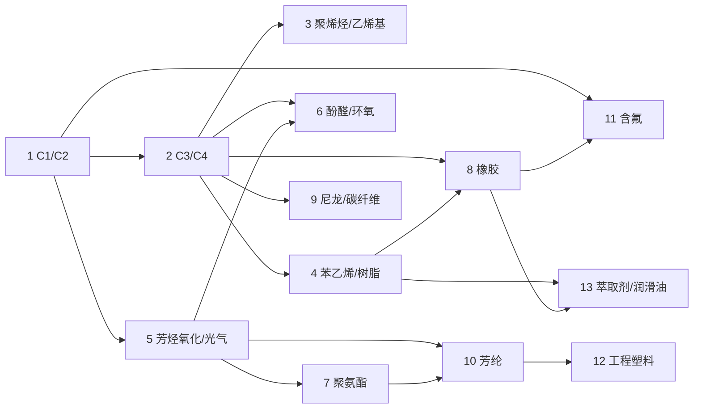

# `ssite` 计划卡总览

依据是 [`docs/supersymmetry-ssite-plan.md`](../supersymmetry-ssite-plan.md) 的里程碑路线图。**M4「纯石化下游：四大高分子与精细化学品」已完成**（见下方 M4 卡）。**M3「纯石化中游：单体分离与内部自循环」已完成**（见下方 M3 卡）。**M2「公用工程：水净化与卤水综合利用」已完成**：利用 GT6CE 已有的水体流体（`Water`、`River_Water`、`Dirty_Water`、`Sewage`、`Sludge`、`Ocean`、`Saltwater`、`Brine`、`DistW`）与内置机器，实装**五级水净化阶梯**（絮凝澄清水 $\rightarrow$ 软化脱矿水 $\rightarrow$ 离子交换去离子水 $\rightarrow$ 高压反渗透纯水 $\rightarrow$ 臭氧紫外电子级超纯水）以及**海水淡化与卤水吹溴、提碘、提锂、提镁综合利用网**。

还没有对外发布过，不做旧存档迁移。

## M4 卡（已完成）

```text
lane            = closed
slug            = m4/index
```

第 1～13 张已关闭并归档至 `docs/card-plans/closed/`。

M4「纯石化下游：四大高分子与精细化学品」第一阶段**只做产出**：每种高分子都能合成、能成型（粉 / 板 / 箔 / 细线 / 锭），但不改任何 GT6 原版配方去消耗它们。消耗端统一留到 M6。

**代码骨架**由第 1 张卡建立，之后各卡都沿用：

- M4 材料全部放进新类 `material/PolymerMaterials`，由 `SsiteMaterials` 拼接；
- 配方全部放进新类 `chemistry/PolymerRecipes`，由 `ChemistryRecipes.add` 在 `PetrochemRecipes.add()` 之后调用；
- 聚合物统一用 `polymerForming` 成型：压板（电路 1）、轧箔，有 `wires()` 的再加拉细线。这个 helper 在第 3 张卡里建立。

**约定**：

1. 同一台机器上如果一条配方的输入是另一条的子集，用编程电路区分，电路一律不消耗；
2. 约 `1000 mB` 单体对应 `1 × dust` 聚合物；
3. 引发剂统一用 M3 的异丙苯过氧化氢（`10 mB`），含氟单体例外，用过硫酸钠；
4. 乳液 / 悬浮聚合统一用 M2 的去离子水作介质。

按依赖分三批。批内各卡可并行；后一批依赖前一批的单体。

**第一批：平台化学品与通用塑料**

| 顺序 | 状态 | 卡 | 做完能看到什么 |
|---|---|---|---|
| 1 | 已关闭 | [`C1/C2 平台化学品`](closed/C1C2平台化学品详细计划.md) | 代码骨架建立；甲醇、甲醛、乙酸（孟山都 / 乙醛氧化 / 醋提纯）、环氧乙烷、乙二醇、平衡氧氯化制氯乙烯、醋酸乙烯；补上 M3 漏掉的普通乙醇配方 |
| 2 | 已关闭 | [`C3/C4 平台化学品与 Prins 异戊二烯`](closed/C3平台化学品与Prins异戊二烯详细计划.md) | 环氧氯丙烷（丙烯法 + 甘油法）、SOHIO 丙烯腈、氢氰酸、丙烯醛 / 丙烯酸、丙酮氰醇法 MMA、正丁醛 / 正丁醇 / 2-乙基己醇、固体磷酸、Prins 异戊二烯 |
| 3 | 已关闭 | [`聚烯烃与乙烯基聚合物`](closed/聚烯烃与乙烯基聚合物详细计划.md) | LDPE、UHMWPE、独立聚丙烯（移除 GT6 丙烯→`Plastic`）、PVC 合成、PVAc / PVA / PVB、EVA；`polymerForming` 建立 |
| 4 | 已关闭 | [`苯乙烯、离子交换树脂与 PMMA`](closed/苯乙烯离子交换树脂与PMMA详细计划.md) | 苯乙烯、二乙烯苯、PS、交联珠、阳 / 阴离子交换树脂；树脂法去离子水（M2 第二路线）、树脂法双酚 A（M3 第二路线）；有机玻璃 |
| 5 | 已关闭 | [`芳烃氧化、光气、PET 与聚碳酸酯`](closed/芳烃氧化光气聚酯与聚碳酸酯详细计划.md) | 邻 / 间 / 对二甲苯各出苯酐 / IPA / PTA；光气；PET（可拉丝）；GT6 聚碳酸酯有了合成路线；镀铝聚酯膜 |

**第二批：热固性树脂与橡胶**

| 顺序 | 状态 | 卡 | 做完能看到什么 |
|---|---|---|---|
| 6 | 已关闭 | [`酚醛与环氧树脂`](closed/酚醛与环氧树脂详细计划.md) | GT6 电木有了合成路线；玻璃纤维；双酚 A / 阻燃 / 邻甲酚醛 / 脂环族四种环氧；玻纤增强环氧板与阻燃层压板 |
| 7 | 已关闭 | [`聚氨酯与石油树脂`](closed/聚氨酯与石油树脂详细计划.md) | 硝基苯 → 苯胺 → MDA → MDI；聚醚多元醇；聚氨酯；原版海绵；DCPD + 苯 + 降冰片烯石油树脂及其加氢 |
| 8 | 已关闭 | [`合成橡胶与硫化`](closed/合成橡胶与硫化详细计划.md) | 炭黑、氧化锌、氧化镁；聚异戊二烯（硫化即 GT6 `Rubber`）、丁苯、丁腈、氯丁、硅橡胶、硬质胶 |

**第三批：纤维与特种材料**

| 顺序 | 状态 | 卡 | 做完能看到什么 |
|---|---|---|---|
| 9 | 已关闭 | [`尼龙 6 与碳纤维`](closed/尼龙6与碳纤维详细计划.md) | 环己酮 → 己内酰胺 → 尼龙 6；PAN 原丝 → 预氧化 → 碳化 → 碳纤维布 |
| 10 | 已关闭 | [`芳纶`](closed/芳纶详细计划.md) | 对苯二胺 / 间苯二胺、两种苯二甲酰氯；Kevlar（只能湿纺织布）与 Nomex |
| 11 | 已关闭 | [`含氟聚合物`](closed/含氟聚合物详细计划.md) | GT6 Teflon 有了合成路线；PVDF；氟橡胶 Viton（可做环）；Nafion |
| 12 | 已关闭 | [`特种工程塑料`](closed/特种工程塑料详细计划.md) | PPS、聚砜、PEEK、Kapton |
| 13 | 已关闭 | [`萃取剂与润滑油基础油`](closed/萃取剂与润滑油基础油详细计划.md) | MIBK、TBP、P204、三辛胺、Aliquat 336；α-烯烃、PAO、聚异丁烯 |

依赖关系：



## M4 与路线图的偏差

- **不单独出材料卡**：M3 用一张卡注册了全部 38 种材料。M4 有一百多种新材料，所以改成每张卡自带自己的材料，按需注册。
- **硫化不用模具，直接出锭**：生胶 + 炭黑 + 硫 + 氧化锌（不消耗）在搅拌机里得到硫化胶锭。硫化胶声明为 `metal()`，和 GT6 `Rubber` 同构，板、环等形态交给 GT6 通用金属加工。
- **GT6 丙烯→`Plastic` 配方被移除**：丙烯改出独立的聚丙烯，`Plastic` 只代表聚乙烯。
- **复用 GT6 自带材料**：`Plastic`（PE）、`PVC`、`Teflon`、`Bakelite`、聚碳酸酯（内部名 `HardPlastic`，配方用别名 `Polycarbonate`）、`Rubber` 不新建，只补合成路线。
- **补遗**：双氰胺固化剂、聚苯醚（PPO）、聚醚酰亚胺（PEI）、尼龙 66 / 己二酸、环氧丙烷、TDI 当时延后，现由下方补遗卡统一补齐。
- **多步折一步**：全氟磺酰基乙烯基醚、二氨基二苯醚、Ziegler 法辛醇、脂环族环氧都把多步工艺折成一两步。
- **副产简化**：MMA、己内酰胺工段的硫酸铵废液折成 `Dirty_Water`；氯化铵、氯化钾、氟化钾等受槽位限制不出槽。
- **溶剂省略**：NMP、二苯砜等高沸点溶剂不做。
- **实现前须在游戏内确认的 GT6CE 名字**：聚碳酸酯内部名、`plate Paper`、硝酸、氢氟酸、过氧化氢、三氧化硫、一氧化氮、发烟硫酸、杂酚油、生石灰、氨的流体字段名，以及 `VanadiumPentoxide` / `CalciumChloride` / `SodiumSulfide` / `PotassiumFluoride` / `PotassiumCarbonate` / `SodiumPersulfate` 粉。各卡验收里都列了对应的确认项。

## M4 补遗卡（待实现）

```text
lane            = open
slug            = m4/deferred-fill
```

| 顺序 | 状态 | 卡 | 做完能看到什么 |
|---|---|---|---|
| 14 | 实现完成，待验收 | [`TDI、环氧丙烷、己二酸 / 尼龙 66、PPO / PEI 与双氰胺`](TDI环氧丙烷尼龙66与PPO详细计划.md) | 15 种新材料；HPPO 环氧丙烷与丙二醇；环己酮 → 己二酸 → 己二腈 → 己二胺 → 尼龙 66；甲苯 → DNT → TDA → TDI 与 TDI 型聚氨酯；苯酚 → 2,6-二甲酚 → PPO；双酚 A → BPADA → PEI；石灰氮 → 双氰胺与环氧第二固化路线 |

## M3 卡（已完成）

```text
lane            = closed
slug            = m3/index
```

第 1～7 张已关闭并归档至 `docs/card-plans/closed/`。GT6CE 只有原油、轻烃、乙烯丙烯和成品燃料流体，**没有原油蒸馏配方，也没有任何芳烃、C4、C5 单体**。所以 M3 先补炼油前段，再按 BTX → C4 → 二甲苯/甲苯 → C5 → 苯酚丙酮的顺序拆单体。石化配方统一放进新类 `PetrochemRecipes`。

| 顺序 | 状态 | 卡 | 做完能看到什么 |
|---|---|---|---|
| 1 | 已关闭 | [`石化中游单体、馏分与催化剂材料`](closed/石化中游材料与流体详细计划.md) | 38 种材料（石脑油、重整油、裂解汽油、裂解碳四、糠醛/环丁砜、BTEX、苯、甲苯、乙苯、邻/间/对二甲苯、C4/C5 单体、苯酚、丙酮、双酚 A、ZSM-5）注册完成 |
| 2 | 已关闭 | [`原油常压蒸馏、石脑油蒸汽裂解与催化重整`](closed/原油蒸馏与石脑油裂解重整详细计划.md) | 五种原油蒸馏出九种馏分（原版燃料第一次有来源），石脑油裂解出裂解碳四与裂解汽油，铂重整出重整油与氢气 |
| 3 | 已关闭 | [`BTX 芳烃糠醛抽提与溶剂循环`](closed/BTX芳烃抽提详细计划.md) | 糠醛萃取、汽提回收（每批损耗约 5%）、BTEX 精馏出苯/甲苯/乙苯/二甲苯，抽余油切 C5 并回裂解 |
| 4 | 已关闭 | [`C4 丁二烯抽提、丁烯拆分与环丁砜溶剂`](closed/C4丁烯拆分与丁二烯详细计划.md) | 丁二烯三条来源（碳四抽提、丁烷/丁烯脱氢、乙醇两步法），丁烯三分，环丁砜作为第二代芳烃溶剂 |
| 5 | 已关闭 | [`二甲苯三兄弟分离、ZSM-5 异构化与甲苯消纳`](closed/二甲苯异构化与甲苯消纳详细计划.md) | ZSM-5 合成；邻位精馏、对位冷冻结晶、间位异构化回对位；甲苯歧化或加氢脱烷基；乙苯烷基化 |
| 6 | 已关闭 | [`C5 馏分热二聚拆解`](closed/C5二聚与双环戊二烯详细计划.md) | C5 热二聚后普通蒸馏出异戊二烯、戊烷、DCPD；DCPD 解聚加乙烯得降冰片烯；戊烷回裂解 |
| 7 | 已关闭 | [`异丙苯法苯酚丙酮联产与双酚 A`](closed/异丙苯法苯酚与双酚A详细计划.md) | 苯 + 丙烯 → 异丙苯 → 苯酚 + 丙酮 → 双酚 A 粉，M3 全线闭环并回填路线图 |

## M3 与路线图的偏差

- **新增炼油前段卡（第 2 张）**：路线图写「承接炼油与裂解」，但 GT6CE 没有炼油，必须自己补
- **对二甲苯结晶改用冷冻机**：`gt.recipe.crystallisationcrucible` 没有流体输出槽，间二甲苯母液出不来，改用 `gt.recipe.freezer`
- **Prins 法异戊二烯移交 M4**：GT6CE 没有甲醛和固体磷酸，和 M4 酚醛树脂的甲醛线一起做
- **「基础衍生物单体」移交 M4**：氯乙烯、醋酸乙烯、环氧乙烷、乙二醇、环氧氯丙烷、丙烯腈、丙烯酸、MMA、苯酐、PTA、间苯二甲酸、己内酰胺、MDI 各自需要整套上游（二氯乙烷、乙酸、氢氰酸、甲醇、甲醛、苯胺、光气），放到 M4 对应高分子家族卡里按需注册
- **乙醇法丁二烯写成两步法（Ostromislensky）**：路线图写的「乙醇 + 乙醛 + 钽催化剂」实际是两步法，Lebedev 一步法不做

## M2 卡（已完成）

```text
lane            = closed
slug            = m2/index
```

第 1～3 张已关闭并归档至 `docs/card-plans/closed/`。M2 全链可在游戏内跑通闭环，为 M3/M4（四溴双酚 A 阻燃环氧、湿法与聚合用水）提供原料。

| 顺序 | 状态 | 卡 | 做完能看到什么 |
|---|---|---|---|
| 1 | 已关闭 | [`水净化与卤水链材料、流体与滤膜`](closed/水净化与卤水材料详细计划.md) | 五级净化水流体、臭氧、明矾、醋酸纤维素（粉/板/反渗透膜箔）与卤水链中间流体/盐类全部注册完成，中英文译名齐全 |
| 2 | 已关闭 | [`五级水净化阶梯与污泥回收产线`](closed/五级水净化产线详细计划.md) | `FluidBridge` 支持概率产出与不消耗催化剂；从河水/污水絮凝、污泥回收、石英砂软化、沸石去离子、醋酸纤维素膜高压反渗透到臭氧紫外超纯水五级阶梯全线跑通 |
| 3 | 已关闭 | [`海水淡化与卤水吹溴提锂镁产线`](closed/海水淡化与卤水综合利用详细计划.md) | 海水/盐水浓缩制苦卤与石膏、熟石灰沉镁纯碱除钙、酸化氯气吹溴精馏提溴碘、富锂母液沉碳酸锂转氯化锂电解金属锂闭环跑通 |

## M2 明确不做

- 不在 M2 新增自定义单方块或多方块机器（统一走 GT6CE 内置 `bath`、`mixer`、`autoclave`、`drying`、`centrifuge`、`distillery`、`distillationtower`、`electrolyzer`、`rollingmill`、`press`；原版 `coagulator`、`sifter`、`laserengraver` 因无对应物品输入或流体输入/输出槽，按真实槽位改由 `bath`、`autoclave`、`mixer` 承接）
- 不在 M2 引入交联聚苯乙烯离子交换树脂的合成（留到 M4 苯乙烯线，M2 第 3 级去离子水用 GT6CE 内置 `Zeolite` 沸石分子筛跑通）
- 不在 M2 修改原版机器或电路板配方对各级纯水的强制消耗门槛（留到 M6 统一挂载下游）

---

## M1 卡（招牌主线：不锈钢没那么容易）

`slug = m1/index`。第 1～4 张已关闭并归档至 `docs/card-plans/closed/`；第 5 张 **AOD 转炉坩埚化重做与多材质炉体** 已完成实现（2026-10-22），等待进游戏验收后归档。

| 顺序 | 状态 | 卡 | 结果 / 目标 |
|---|---|---|---|
| 1 | 已关闭 | [`砍掉不锈钢捷径与挂接服务`](closed/砍掉不锈钢捷径详细计划.md) | SPI 服务挂通；坩埚合不出原版不锈钢，搅拌机移除 12 条熔融不锈钢配方 |
| 2 | 已关闭 | [`不锈钢冶金材料与 316L 管道`](closed/不锈钢冶金材料详细计划.md) | 铬铁、硅铁、高碳不锈钢、316L 钼不锈钢、铬盐与 316L 耐酸流体管进游戏，中英文译名齐全 |
| 3 | 已关闭 | [`AOD 转炉机器与配方表`](closed/AOD转炉机器详细计划.md) | 初版 `ssite:aod_converter` 机器方块与 `ssite.recipe.aod` 配方表注册成功 |
| 4 | 已关闭 | [`铬铁初炼与 AOD 三档精炼产线`](closed/不锈钢精炼产线详细计划.md) | 铬铁、化工铬、硅铁、坩埚初炼高碳粗钢与初版 AOD 精炼配方跑通 |
| 5 | **实现完成，待验收** | [`AOD 转炉坩埚化重做与多材质炉体`](AOD转炉坩埚化详细计划.md) | 移除 UI 槽位式 AOD，重做为 \(1\times 1\times 2\) 底部坩埚 + 顶部可开关盖结构，四面可接氩气管 + `KU` 驻留氩气，实装钢/不锈钢/铌钛/钨钢/钨/碳化钽铪六档炉体并以钼熔点（\(2896\text{ K}\)）自然卡住 316L |
| 远期记账 | 记账 | 大型多方块 AOD 转炉（Large AOD Converter） | 对标 GT6 大坩埚（`MultiBlockCrucible`）的大容量多方块版本，后续单独开卡 |

---

## 灵感池

尚未排期、也不做成计划卡的构想记在 [`docs/inspiration.md`](../inspiration.md)，目前有电弧坩埚（EAF / VAR）与钛铝反应器三分法。
